# Bianbu Next 详细设计补全（LLD-Detailed，aicoder-ready）

| 项 | 内容 |
|----|------|
| 文档编号 | BN-LLD-002 |
| 版本 | V1.0 |
| 来源 | 补全 BN-LLD-001 V1.1，依 BN-LLD-GOAL-001 完成清单 + BN-API-001 + BN-HLD-001/002 + SRS + worker 实测 |
| 日期 | 2026-07-08 |
| 状态 | 待评审 |

> 本文件是 `04_Bianbu_Next_LLD.md` 的**补全件**，只补该文缺失的 aicoder-ready 内容（各模块 d/f/g、D-Bus 机器可读契约、数据 schema、调用/错误矩阵、集中配置清单、时序补全、FR→测试点映射、calendard 全套、剩余 TBD 回填），不重复其正文。两文件合读构成完整 LLD。
> 责任组：A 引擎(aihald) / B 底座(runtimed,securityd) / C 数据(memoryd,indexerd) / D 交互(skilld,intentd,calendard) / E 生态(SDK/CLI/接入层，契约总集成)。
>
> **文档边界**：**总体架构 / 子系统架构 / 全景数据流由 HLD（BN-HLD-002）承担，本文不重复**（对齐 AGENTS.md「六层架构与命名以 HLD 为准」）。本文只画 LLD 职责的**实现级图**：跨服务时序图、模块状态机图、关键算法流程图（见 §10）。图与既有表格/伪代码**双轨并存**——表格/伪代码喂 aicoder，mermaid 图供人工评审。

---

## 0. 全局约定与术语（补 GOAL 0.3 / 0.4）

### 0.3 全局约定（LLD 收口）
- **命名**：服务进程 `bianbu-<name>d`；D-Bus 服务名 `io.bianbu.<Iface>`；对象路径 `/io/bianbu/<Iface>`；能力标识小写点分 `domain.verb`（如 `file.write`）。
- **错误码域**：统一 `io.bianbu.Error.*`（见 §2.4 全集）。方法失败一律返回该域错误，不返回裸字符串。
- **status 返回**：写操作返回 `s(status)`，取值枚举 `ok | pending | denied | error`（细分见各模块 f）。
- **时间戳**：一律 UTC int64 毫秒（`ts_ms`）。
- **类型签名**：D-Bus 签名记法 s/i/x/d/b/a/{}/v/()（对齐 BN-API-001）。
- **trace_id**：入口生成 UUIDv4，随所有跨服务调用经 D-Bus 头 `x-bianbu-trace` 透传，落审计与日志。
- **ID 规范**：`agent_id` = manifest.id（反向域名）；`request_id`/`ckpt_id`/`skill_id`/`event_id` 为 `<prefix>-<UUIDv4>`。

### 0.4 术语与缩略语表
| 缩写 | 全称 | 定义 |
|------|------|------|
| IME | Integrated Matrix Engine | SpacemiT 矩阵加速引擎；A100=IME2、X100=IME1 |
| TCM | Tightly-Coupled Memory | 紧耦合内存，IME2 配套低延迟片上内存 |
| RVV | RISC-V Vector | RISC-V 向量扩展，IME 未覆盖算子的回退层 |
| EP | Execution Provider | onnxruntime 执行后端（本项目用 spacemit-ep） |
| FSM | Finite State Machine | 有限状态机 |
| ANN | Approximate Nearest Neighbor | 近似最近邻检索（LanceDB） |
| KV Cache | Key-Value Cache | Transformer 注意力键值缓存 |
| VAD | Voice Activity Detection | 语音活动检测 |
| MCP | Model Context Protocol | 模型上下文/工具调用协议 |
| HITL | Human-in-the-loop | 人工介入确认 |
| GGUF | — | llama.cpp 量化模型格式 |
| WAL | Write-Ahead Logging | SQLite 预写日志模式 |

---

## 1. 契约冻结顺序与责任（补 GOAL 第二部分总纲）

全局阻塞点，按此顺序冻结接口，冻结后消费方评审签字：
1. **B 组** `io.bianbu.Security` + `io.bianbu.Runtime` 最先冻结（几乎所有服务依赖）。
2. **A 组** `io.bianbu.AIHal` 次之（memoryd/indexerd/skilld/intentd 四消费方依赖）。
3. **C/D 组** 依赖 A、B 冻结后并行。
4. **E 组** 汇总全部 introspection XML、集中配置清单、集成测试。

---

## 2. D-Bus 机器可读契约（补 GOAL 2.1/2.2）

每接口的 introspection XML 置于 `/usr/share/dbus-1/interfaces/io.bianbu.<Iface>.xml`，作为各语言 stub 生成源（gdbus-codegen / dbus-python）。以下为精确签名。

### 2.1 io.bianbu.Security（B 组，最先冻结）
```xml
<!-- io.bianbu.Security.xml -->
<node>
 <interface name="io.bianbu.Security">
  <method name="VerifyManifest">
   <arg name="agent_pkg_path" type="s" direction="in"/>
   <arg name="valid" type="b" direction="out"/>
   <arg name="reason" type="s" direction="out"/>
   <arg name="perms" type="aa{sv}" direction="out"/>
  </method>
  <method name="RegisterCapabilities">
   <arg name="agent_id" type="s" direction="in"/>
   <arg name="perms" type="aa{sv}" direction="in"/>
   <arg name="ok" type="b" direction="out"/>
  </method>
  <method name="CheckPermission">
   <arg name="agent_id" type="s" direction="in"/>
   <arg name="capability" type="s" direction="in"/>
   <arg name="scope" type="s" direction="in"/>
   <arg name="decision" type="i" direction="out"/>  <!-- 0=ALLOW 1=CONFIRM 2=DENY -->
  </method>
  <method name="RequestConfirm">
   <arg name="agent_id" type="s" direction="in"/>
   <arg name="capability" type="s" direction="in"/>
   <arg name="detail" type="s" direction="in"/>
   <arg name="approved" type="b" direction="out"/>
  </method>
  <method name="RevokePermission">
   <arg name="agent_id" type="s" direction="in"/>
   <arg name="capability" type="s" direction="in"/>
   <arg name="ok" type="b" direction="out"/>
  </method>
  <method name="BuildSandboxPolicy">
   <arg name="agent_id" type="s" direction="in"/>
   <arg name="seccomp_path" type="s" direction="out"/>
   <arg name="netfilter_rules" type="s" direction="out"/>
  </method>
  <method name="MeterTokens">
   <arg name="agent_id" type="s" direction="in"/>
   <arg name="tokens" type="x" direction="in"/>
   <arg name="scope" type="s" direction="in"/>
   <arg name="within" type="b" direction="out"/>
   <arg name="remaining" type="x" direction="out"/>
  </method>
  <method name="AuditLog">
   <arg name="agent_id" type="s" direction="in"/>
   <arg name="op_type" type="s" direction="in"/>
   <arg name="target" type="s" direction="in"/>
   <arg name="result" type="s" direction="in"/>
   <arg name="seq" type="x" direction="out"/>
  </method>
  <method name="ExportAudit">
   <arg name="filter_json" type="s" direction="in"/>
   <arg name="format" type="s" direction="in"/>
   <arg name="export_path" type="s" direction="out"/>
  </method>
  <method name="VerifyAuditChain">
   <arg name="export_path" type="s" direction="in"/>
   <arg name="intact" type="b" direction="out"/>
  </method>
  <method name="SetNetworkPolicy">
   <arg name="scope" type="s" direction="in"/>
   <arg name="domains" type="as" direction="in"/>
   <arg name="mode" type="s" direction="in"/>
   <arg name="ok" type="b" direction="out"/>
  </method>
  <method name="GetSecret">
   <arg name="agent_id" type="s" direction="in"/>
   <arg name="key" type="s" direction="in"/>
   <arg name="value" type="s" direction="out"/>  <!-- 经 CheckPermission 门控；Key Vault 读取 -->
  </method>
  <method name="PutSecret">
   <arg name="agent_id" type="s" direction="in"/>
   <arg name="key" type="s" direction="in"/>
   <arg name="value" type="s" direction="in"/>
   <arg name="ok" type="b" direction="out"/>
  </method>
  <method name="GetEffectivePermissions">
   <arg name="agent_id" type="s" direction="in"/>
   <arg name="perms" type="aa{sv}" direction="out"/>  <!-- 当前已授权能力+态，供 Agent 自查/SET 面板 -->
  </method>
  <signal name="SecurityAlert">
   <arg name="agent_id" type="s"/>
   <arg name="type" type="s"/>
   <arg name="detail" type="s"/>
  </signal>
 </interface>
</node>
```

### 2.2 io.bianbu.Runtime（B 组）
```xml
<node>
 <interface name="io.bianbu.Runtime">
  <method name="Start"><arg name="agent_id" type="s" direction="in"/><arg name="status" type="s" direction="out"/></method>
  <method name="Pause"><arg name="agent_id" type="s" direction="in"/><arg name="snapshot" type="b" direction="in"/><arg name="status" type="s" direction="out"/></method>
  <method name="Resume"><arg name="agent_id" type="s" direction="in"/><arg name="status" type="s" direction="out"/></method>
  <method name="Stop"><arg name="agent_id" type="s" direction="in"/><arg name="status" type="s" direction="out"/></method>
  <method name="Terminate"><arg name="agent_id" type="s" direction="in"/><arg name="status" type="s" direction="out"/></method>
  <method name="Checkpoint"><arg name="agent_id" type="s" direction="in"/><arg name="ckpt_id" type="s" direction="out"/></method>
  <method name="Restore"><arg name="agent_id" type="s" direction="in"/><arg name="ckpt_id" type="s" direction="in"/><arg name="status" type="s" direction="out"/></method>
  <method name="ListCheckpoints"><arg name="agent_id" type="s" direction="in"/><arg name="list" type="aa{sv}" direction="out"/></method>
  <method name="GetResourceStats"><arg name="agent_id" type="s" direction="in"/><arg name="stats" type="a{sv}" direction="out"/></method>
  <method name="ExportResourceHistory"><arg name="agent_id" type="s" direction="in"/><arg name="format" type="s" direction="in"/><arg name="path" type="s" direction="out"/></method>
  <method name="List"><arg name="agents" type="aa{sv}" direction="out"/></method>
  <method name="SendMessage"><arg name="from" type="s" direction="in"/><arg name="to" type="s" direction="in"/><arg name="payload" type="s" direction="in"/><arg name="ok" type="b" direction="out"/></method>
  <method name="GetRuntimeInfo"><arg name="info" type="a{sv}" direction="out"/></method>
  <method name="SetPriority"><arg name="agent_id" type="s" direction="in"/><arg name="priority" type="i" direction="in"/><arg name="ok" type="b" direction="out"/></method>
  <method name="HealthCheck"><arg name="agent_id" type="s" direction="in"/><arg name="healthy" type="b" direction="out"/><arg name="detail" type="s" direction="out"/></method>
  <method name="WatchdogPing"><arg name="agent_id" type="s" direction="in"/><arg name="ok" type="b" direction="out"/></method>
  <method name="ExportCheckpoint"><arg name="agent_id" type="s" direction="in"/><arg name="ckpt_id" type="s" direction="in"/><arg name="export_path" type="s" direction="out"/></method>
  <method name="ImportCheckpoint"><arg name="agent_id" type="s" direction="in"/><arg name="import_path" type="s" direction="in"/><arg name="ckpt_id" type="s" direction="out"/></method>
  <signal name="StateChanged"><arg name="agent_id" type="s"/><arg name="old" type="s"/><arg name="new" type="s"/></signal>
  <signal name="ResourceExceeded"><arg name="agent_id" type="s"/><arg name="resource" type="s"/><arg name="value" type="x"/></signal>
 </interface>
</node>
```

### 2.3 io.bianbu.AIHal（A 组）
```xml
<node>
 <interface name="io.bianbu.AIHal">
  <method name="Generate"><arg name="prompt" type="s" direction="in"/><arg name="model_name" type="s" direction="in"/><arg name="params" type="a{sv}" direction="in"/><arg name="request_id" type="s" direction="out"/></method>
  <method name="GenerateSync"><arg name="prompt" type="s" direction="in"/><arg name="model_name" type="s" direction="in"/><arg name="params" type="a{sv}" direction="in"/><arg name="text" type="s" direction="out"/></method>
  <method name="Embed"><arg name="text" type="s" direction="in"/><arg name="model_name" type="s" direction="in"/><arg name="vector" type="ad" direction="out"/></method>
  <method name="LoadModel"><arg name="model_name" type="s" direction="in"/><arg name="model_path" type="s" direction="in"/><arg name="status" type="s" direction="out"/></method>
  <method name="UnloadModel"><arg name="model_name" type="s" direction="in"/><arg name="status" type="s" direction="out"/></method>
  <method name="SwitchModel"><arg name="agent_id" type="s" direction="in"/><arg name="from" type="s" direction="in"/><arg name="to" type="s" direction="in"/><arg name="status" type="s" direction="out"/></method>
  <method name="GetStatus"><arg name="status" type="a{sv}" direction="out"/></method>
  <method name="SetEndpointPolicy"><arg name="scope" type="s" direction="in"/><arg name="policy" type="s" direction="in"/><arg name="ok" type="b" direction="out"/></method>
  <method name="ListModels"><arg name="filter" type="s" direction="in"/><arg name="models" type="aa{sv}" direction="out"/></method>
  <signal name="TokenStream"><arg name="request_id" type="s"/><arg name="token" type="s"/><arg name="done" type="b"/></signal>
  <signal name="ModelStateChanged"><arg name="model_name" type="s"/><arg name="state" type="s"/></signal>
 </interface>
</node>
```

### 2.4 io.bianbu.Memory / Skill / Intent / Calendar（C/D 组）
```xml
<!-- io.bianbu.Memory.xml -->
<node>
 <interface name="io.bianbu.Memory">
  <method name="Store"><arg name="agent_id" type="s" direction="in"/><arg name="key" type="s" direction="in"/><arg name="value" type="s" direction="in"/><arg name="ttl_ms" type="x" direction="in"/><arg name="status" type="s" direction="out"/></method>
  <method name="Get"><arg name="agent_id" type="s" direction="in"/><arg name="key" type="s" direction="in"/><arg name="value" type="s" direction="out"/></method>
  <method name="Retrieve"><arg name="agent_id" type="s" direction="in"/><arg name="query" type="s" direction="in"/><arg name="top_k" type="i" direction="in"/><arg name="results" type="a(sd)" direction="out"/></method>
  <method name="Delete"><arg name="agent_id" type="s" direction="in"/><arg name="key" type="s" direction="in"/><arg name="status" type="s" direction="out"/></method>
  <method name="Clear"><arg name="agent_id" type="s" direction="in"/><arg name="status" type="s" direction="out"/></method>
  <method name="Backup"><arg name="agent_id" type="s" direction="in"/><arg name="account_token" type="s" direction="in"/><arg name="status" type="s" direction="out"/></method>
 </interface>
</node>
```
```xml
<!-- io.bianbu.Skill.xml -->
<node>
 <interface name="io.bianbu.Skill">
  <method name="Register"><arg name="skill_id" type="s" direction="in"/><arg name="manifest" type="a{sv}" direction="in"/><arg name="ok" type="b" direction="out"/></method>
  <method name="Discover"><arg name="query" type="s" direction="in"/><arg name="skills" type="aa{sv}" direction="out"/></method>
  <method name="Invoke"><arg name="skill_id" type="s" direction="in"/><arg name="function" type="s" direction="in"/><arg name="args" type="a{sv}" direction="in"/><arg name="result" type="v" direction="out"/></method>
  <method name="Install"><arg name="skill_pkg_path" type="s" direction="in"/><arg name="ok" type="b" direction="out"/><arg name="perms_to_confirm" type="aa{sv}" direction="out"/></method>
  <method name="Uninstall"><arg name="skill_id" type="s" direction="in"/><arg name="ok" type="b" direction="out"/></method>
  <method name="List"><arg name="filter" type="s" direction="in"/><arg name="skills" type="aa{sv}" direction="out"/></method>
  <method name="SetEnabled"><arg name="skill_id" type="s" direction="in"/><arg name="enabled" type="b" direction="in"/><arg name="ok" type="b" direction="out"/></method>
  <method name="McpExpose"><arg name="skill_id" type="s" direction="in"/><arg name="mcp_endpoint" type="s" direction="out"/></method>
  <method name="McpCall"><arg name="external_tool" type="s" direction="in"/><arg name="args" type="a{sv}" direction="in"/><arg name="result" type="v" direction="out"/></method>
 </interface>
</node>
```
```xml
<!-- io.bianbu.Intent.xml -->
<node>
 <interface name="io.bianbu.Intent">
  <method name="Parse"><arg name="text" type="s" direction="in"/><arg name="session_id" type="s" direction="in"/><arg name="intent" type="s" direction="out"/><arg name="slots" type="a{sv}" direction="out"/><arg name="conf" type="d" direction="out"/></method>
  <method name="ParseWithContext"><arg name="text" type="s" direction="in"/><arg name="session_id" type="s" direction="in"/><arg name="intent" type="s" direction="out"/><arg name="slots" type="a{sv}" direction="out"/><arg name="conf" type="d" direction="out"/></method>
  <method name="Transcribe"><arg name="audio_path" type="s" direction="in"/><arg name="text" type="s" direction="out"/></method>
  <method name="Speak"><arg name="text" type="s" direction="in"/><arg name="voice" type="s" direction="in"/><arg name="status" type="s" direction="out"/></method>
  <method name="Wake"><arg name="woken" type="b" direction="out"/></method>
 </interface>
</node>
```
```xml
<!-- io.bianbu.Calendar.xml -->
<node>
 <interface name="io.bianbu.Calendar">
  <method name="ListEvents"><arg name="from" type="x" direction="in"/><arg name="to" type="x" direction="in"/><arg name="events" type="aa{sv}" direction="out"/></method>
  <method name="CreateEvent"><arg name="event" type="a{sv}" direction="in"/><arg name="event_id" type="s" direction="out"/></method>
  <method name="SetReminder"><arg name="event_id" type="s" direction="in"/><arg name="remind_at" type="x" direction="in"/><arg name="tts" type="b" direction="in"/><arg name="ok" type="b" direction="out"/></method>
  <signal name="ReminderFired"><arg name="event_id" type="s"/><arg name="title" type="s"/></signal>
 </interface>
</node>
```
> 7/7 接口 introspection XML 齐备（Security/Runtime/AIHal §2.1–2.3，Memory/Skill/Intent/Calendar 本节）。落地为独立 `.xml` 文件时按此内容拆分。

### 2.5 a{sv} 数据 schema（补 GOAL 2.2）
每个字典的 key / 类型 / 必填性：

**Permission（perms 元素）** — VerifyManifest/RegisterCapabilities
| key | type | 必填 | 说明 |
|-----|------|------|------|
| capability | s | 是 | 能力标识 |
| domain | s | 是 | execute\|resource\|data\|system |
| risk_level | s | 是 | L1\|L2\|L3\|L4 |
| confirm | s | 是 | always\|once_per_session\|trusted |
| scope | s | 否 | 文件类能力必填 |

**Generate params** — Generate/GenerateSync
| key | type | 默认 | 说明 |
|-----|------|------|------|
| max_tokens | i | 512 | 上限 |
| temperature | d | 0.7 | 0.0–2.0 |
| stream | b | true | 流式经 TokenStream |
| priority | i | 0 | 抢占优先级，越大越高 |
| allow_cloud | b | false | 是否允许端云路由 |

**AgentStatus** — Runtime.List/GetResourceStats
| key | type | 说明 |
|-----|------|------|
| agent_id | s | — |
| name | s | 显示名 |
| state | s | INSTALLED\|RUNNING\|PAUSED\|STOPPED\|TERMINATED |
| cpu_pct | d | 0–100×核数 |
| mem_mb | x | RSS MB |
| uptime_s | x | 运行秒数 |

**Event（Calendar）**
| key | type | 必填 | 说明 |
|-----|------|------|------|
| title | s | 是 | — |
| start | x | 是 | UTC ms |
| end | x | 是 | UTC ms |
| location | s | 否 | — |
| description | s | 否 | — |

**SkillManifest（Skill.Register/Install 的 manifest 元素）**
| key | type | 必填 | 说明 |
|-----|------|------|------|
| skill_id | s | 是 | 反向域名格式，如 com.bianbu.file-search |
| name | s | 是 | 显示名 |
| version | s | 是 | semver，如 1.0.0 |
| description | s | 否 | — |
| triggers | as | 否 | 触发词列表 |
| entry | s | 是 | entry.py:function |
| timeout | i | 否 | 秒，默认 30 |
| risk_level | s | 是 | L1\|L2\|L3\|L4（最高权限等级） |

**IntentSlots（Intent.Parse 返回的 slots 字典元素）**
| key | type | 说明 | 示例 |
|-----|------|------|------|
| time_from | x | 时间范围起，UTC ms（时间类意图） | — |
| time_to | x | 时间范围止，UTC ms | — |
| file_query | s | 文件搜索关键词 | "Agent 调度" |
| app_name | s | 目标应用名 | "Firefox" |
| app_action | s | 应用操作 | "search" |
| entity | s | 通用命名实体 | — |
| index_ref | i | 上下文结果集索引（指代消解，如"第一个"→0） | 0 |

**ModelEntry（AIHal.ListModels 返回的 models 元素）**
| key | type | 必填 | 说明 |
|-----|------|------|------|
| name | s | 是 | 模型名 |
| path | s | 是 | 文件路径 |
| format | s | 是 | GGUF\|ONNX |
| backend | s | 是 | ggml-spacemit\|onnx-spacemit\|cloud |
| state | s | 是 | LOADED\|CACHED\|UNLOADED |
| mem_bytes | x | 是 | 当前占用内存，0 表示未加载 |
| last_used | x | 否 | UTC ms |

**CheckpointEntry（Runtime.ListCheckpoints 返回元素）**
| key | type | 必填 | 说明 |
|-----|------|------|------|
| ckpt_id | s | 是 | 格式 ckpt-&lt;UUIDv4&gt; |
| agent_id | s | 是 | — |
| ts | x | 是 | 创建时间 UTC ms |
| size_bytes | x | 是 | 快照大小 |
| trigger | s | 是 | auto\|manual\|pre_stop |
每方法内部回调的其他接口 + 同步(S)/异步(A) + 超时。

| 方法 | 内部调用 | 模式 | 超时 |
|------|----------|------|------|
| Runtime.Start | Security.BuildSandboxPolicy(S) → Security.AuditLog(A) | S | 200ms（含沙箱） |
| AIHal.Generate | Security.CheckPermission(S) → route → Security.MeterTokens(A) → Security.AuditLog(A) | A（流式） | 首token 200ms；整体 params.deadline |
| Memory.Retrieve | AIHal.Embed(S) → LanceDB ANN(本地) | S | 100ms |
| Memory.Store | AIHal.Embed(S, 仅文本) → SQLite+LanceDB | S | 500ms |
| Skill.Invoke | Security.CheckPermission(S) → [AIHal.Generate(A) 可选] → Runtime 沙箱执行(S) → Security.AuditLog(A) | S | skill.timeout 默认 30s |
| Intent.Parse | AIHal.GenerateSync(S, 0.5B 分类) | S | 200ms |
| Intent.Transcribe | 本地 Whisper（无跨服务） | S | 500ms/s 音频 |
| Calendar.CreateEvent | Security.CheckPermission(S) → EDS(S) → Security.AuditLog(A) | S | 2s |
| indexer 检索 | AIHal.Embed(S) → LanceDB ANN | S | 2s |

### 2.7 错误传播矩阵（补 GOAL 2.4）
错误码全集：`PermissionDenied / ConfirmRequired / NotFound / InvalidArgument / QuotaExceeded / Unavailable / Internal / Timeout`。

| 调用点 | 可能错误 | 调用方处理 |
|--------|----------|-----------|
| CheckPermission=DENY | （返回 decision=2，非错误） | 调用方终止操作，记审计 |
| CheckPermission=CONFIRM | → RequestConfirm；拒绝→ ConfirmRequired | Loop 暂停等待 HITL；拒绝则结束 |
| MeterTokens within=false | QuotaExceeded | securityd 发 `TokenExceeded`/`SecurityAlert`；Agent Runtime/agent 消费事件后暂停或终止并通知 |
| Generate 模型缺失 | NotFound | 上层报模型未加载；不重试 |
| Generate 后端失败 | Unavailable | 按 fallback 链换后端；云不可达→本地 best-effort；不静默 |
| Embed 失败 | Unavailable | Memory/indexer 降级为仅关键字（记 warn），不阻断写 |
| Sandbox 构建失败 | Internal | **fail-closed**：Start 拒绝，Agent 不启动 |
| AuditLog 写失败 | Internal | **fail-closed**：阻断相关操作 + SecurityAlert |
| Skill.Invoke 工具超时 | Timeout | 按 App fallback 链降级；全失败返回 Timeout |
| Calendar EDS 不可达 | Unavailable | 返回错误，不静默；提示用户 |

---

## 3. 各模块补全 d/f/g（补 GOAL 第一部分缺口）

### 3.1 securityd（补 d 状态机 / f 契约 / g 配置）

**d. 权限决策状态机**（每 (agent_id,cap,scope) 的授权态）
```
状态: UNDECLARED, DECLARED, GRANTED, SESSION_TRUSTED, REVOKED
转换（拒绝表外）:
  UNDECLARED --RegisterCapabilities--> DECLARED
  DECLARED --用户授权--> GRANTED
  GRANTED --confirm=once,本会话首次确认--> SESSION_TRUSTED
  SESSION_TRUSTED --会话结束--> GRANTED
  GRANTED --RevokePermission--> REVOKED
  SESSION_TRUSTED --RevokePermission--> REVOKED
  REVOKED --RegisterCapabilities(重装)--> DECLARED
```
CheckPermission 读此态：GRANTED+trusted→ALLOW；GRANTED+once→CONFIRM(通过后转 SESSION_TRUSTED)；SESSION_TRUSTED→ALLOW；L4 恒 CONFIRM；REVOKED/UNDECLARED→DENY。

**f. 接口契约**
| 方法 | status/输出枚举 | 错误分支 | 超时/重试 |
|------|-----------------|----------|-----------|
| CheckPermission | decision∈{0,1,2} | 无（查询恒返回） | 10ms，不重试 |
| RequestConfirm | approved∈{true,false} | 弹窗超时→false | 用户交互无服务超时；GUI 侧 60s 默认拒绝 |
| MeterTokens | within,remaining | remaining<0 截断为 0 | 原子操作，无重试 |
| AuditLog | seq≥1 | 写失败→Internal + fail-closed | 单写线程串行，失败告警 |
| VerifyAuditChain | intact∈{true,false} | 文件缺失→NotFound | — |
| GetSecret | value（非空） | 未授权→PermissionDenied；key 不存在→NotFound | 经 CheckPermission 门控，不缓存明文 |
| PutSecret | ok | 未授权→PermissionDenied；写失败→Internal | 值经 Key Vault 加密落盘 |
| GetEffectivePermissions | perms(aa{sv}) | agent 不存在→NotFound | 只读自身；跨 agent 查询→PermissionDenied |

> **Secret schema（GetSecret/PutSecret 的 value）**：value 为 UTF-8 字符串（API Key/OAuth Token 等）；存储经 Key Vault（§11.3：gnome-keyring 或 age 加密文件 + root-only），普通 Agent 仅能读写**自身命名空间**且须持 `secret.read`/`secret.write` 能力（L2/L3）。
> **EffectivePermissions 元素**：复用 §2.5 Permission schema，额外附 `state`（DECLARED\|GRANTED\|SESSION_TRUSTED\|REVOKED，见 §3.1 权限态机）。

**g. 配置项**
| 参数 | 默认 | 范围 | 来源 |
|------|------|------|------|
| capabilities.db 路径 | /etc/bianbu/capabilities.db | 路径 | 固定 |
| audit 段大小轮转 | 64MB | 16–256MB | 可调 |
| confirm 弹窗超时 | 60s | 10–300s | 可调 |
| token 计量口径 | prompt+completion 双向 | 双向\|仅completion | [TBD-2] 回填=双向 |
| 本地推理是否计入预算 | 否 | 是\|否 | [TBD-3] 回填=否 |

#### 3.1.1 securityd 子系统架构（Agent OS Security Manager）
> securityd 不是传统 Linux security service，而是 **Agent OS 安全管理器**：以 Capability 为核心，串起安装校验、权限判定、用户授权、沙箱策略编译、配额、审计、网络策略、密钥与告警。下图为其内部子模块划分（LLD 子系统级视图，供 aicoder 与评审参照；总体六层架构见 HLD BN-HLD-002）。

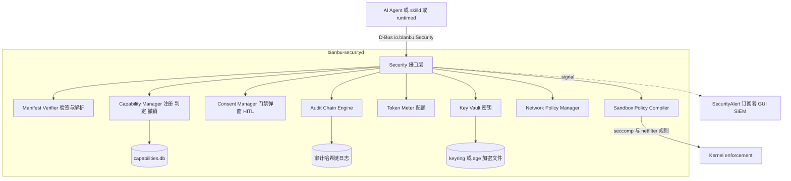

**子模块与接口映射（7+1 模块）**
| 子模块 | 接口 | 职责 |
|--------|------|------|
| Manifest Verifier | VerifyManifest | ed25519 验签 + 解析权限声明 |
| Capability Manager | RegisterCapabilities / CheckPermission / RevokePermission / GetEffectivePermissions | 能力注册、0/1/2 权限判定、撤销、自查 |
| Consent Manager | RequestConfirm | 动态用户授权弹窗（HITL） |
| Sandbox Policy Compiler | BuildSandboxPolicy | Capability → seccomp-bpf + netfilter + cgroup + bind-mount + cap drop |
| Token Meter | MeterTokens | 会话/日配额判定与剩余额度 |
| Audit Chain Engine | AuditLog / ExportAudit / VerifyAuditChain | 不可篡改哈希链、导出、完整性校验 |
| Network Policy Manager | SetNetworkPolicy | allowlist/denylist + 学习模式 |
| Key Vault（+1） | GetSecret / PutSecret | 敏感凭据加密存取（无 TEE → 软件方案） |
| （事件） | signal SecurityAlert | 权限越界/异常向 GUI/SIEM 广播 |

**决策增强点（相对静态权限）**：CheckPermission 当前按 risk_level + confirm 静态判定；预留 **Risk Engine 扩展点**——可按操作上下文（目标敏感度、频率、时段）动态抬升 ALLOW→CONFIRM→DENY（见 §3.1.2 未来扩展，预研，不入本期冻结契约）。

**Capability → Linux enforcement 编译链**（BuildSandboxPolicy 内部）：
```
Manifest capability (如 file.write scope=~/Documents)
  → 归一化为 domain+risk_level+scope
  → 编译: seccomp-bpf 白名单(syscall) + netfilter(域名) + cgroup(资源) + bind-mount(文件视图) + cap drop
  → 落 /run/security/<agent_id>.{seccomp,nft}
  → runtimed 于 execve 前加载 (fail-closed)
说明: 当前不含 AppArmor/Landlock（未来可作增强层），以 seccomp+bind-mount+cap drop 为准（worker 实机校准）
```

#### 3.1.2 securityd 未来扩展接口（预研，不入本期冻结契约）
> 记录方向与 rationale，避免后续设计漂移；**本期契约冻结不含以下方法**，实现时经版本化接口新增。

| 方向 | 设想方法 | rationale | 归属 |
|------|----------|-----------|------|
| Identity | IssueAgentCertificate / RotateKey | Agent 身份证书与密钥轮换，绑 Agent Hub 签名体系 | ECO/未来 |
| Session Security | GrantDelegation / IssueSessionToken | 运行时委托与临时权限（比 once_per_session 更细） | 未来 |
| Risk Engine | EvaluateRisk | 基于操作风险动态调整 ALLOW/CONFIRM/DENY | 预研 |
| Secret 高级 | RotateSecret / ListSecrets | 凭据轮换与枚举（本期仅 Get/Put） | 未来 |

### 3.2 aihald（补 d / f / g，回填 [TBD-15] 锚点）

**d. 模型实例状态机**
```
状态: UNLOADED, LOADING, LOADED, CACHED, UNLOADING
  UNLOADED --LoadModel--> LOADING --成功--> LOADED
  LOADING --失败--> UNLOADED (返回 Unavailable)
  LOADED --refcount==0 & 内存压力--> CACHED
  CACHED --再次 LoadModel--> LOADED (refcount++)
  CACHED --内存不足淘汰--> UNLOADING --> UNLOADED
  LOADED --UnloadModel & refcount==0--> UNLOADING --> UNLOADED
```

**f. 接口契约**
| 方法 | status/输出枚举 | 错误分支 | 超时/重试 |
|------|-----------------|----------|-----------|
| LoadModel | ok\|already_loaded\|error | 文件缺失→NotFound；OOM→Unavailable | 加载超时 30s，不自动重试 |
| Generate | request_id（异步，token 经 signal） | 模型缺→NotFound；后端失败→Unavailable(走fallback) | 首token 200ms 目标[TBD-15]；params.deadline 截断 |
| GenerateSync | text | 同上 | deadline 默认 30s |
| Embed | vector(ad,固定维度) | 后端失败→Unavailable | 100ms 目标 |
| SwitchModel | ok\|error | to 加载失败→保持 from，返回 Unavailable | 2s 目标[TBD-15] |

**g. 配置项**
| 参数 | 默认 | 范围 | 来源 |
|------|------|------|------|
| batch_window | 10ms | 0–50ms | 可调 |
| batch_max_size | 8 | 1–32（受内存） | 可调 |
| kv_pool 上限 | 内存 40% | 10–70% | 可调 |
| kv 碎片目标 | ≤10% | — | FR-AI-22 |
| 抢占粒度 | token 边界 ≤100ms | — | FR-AI-08 |
| 后端优先级 | ggml-spacemit→onnx-spacemit→cloud | — | AGENTS.md |
| local_confidence 阈值 | 0.85 | 0–1 | FR-AI-18 |
| 首 token 目标 | 200ms | — | [TBD-15] 实测锁定 |

#### 3.2.1 aihald 子系统架构（AI Runtime + AI HAL）
> aihald 把"推理"变成系统调用：向上以 AI HAL 提供统一能力接口（LLM/ASR/TTS/Vision/OCR/Embedding），向下以 AI Runtime 管理模型资源与多后端调度。**它管算力供给，不管 Agent 生命周期**（那是 runtimed）。SpacemiT 定制栈：LLM=ggml-spacemit、视觉/OCR=onnxruntime+spacemit-ep，IME2/TCM、IME1，回退 RVV/CPU（见 AGENTS.md）。

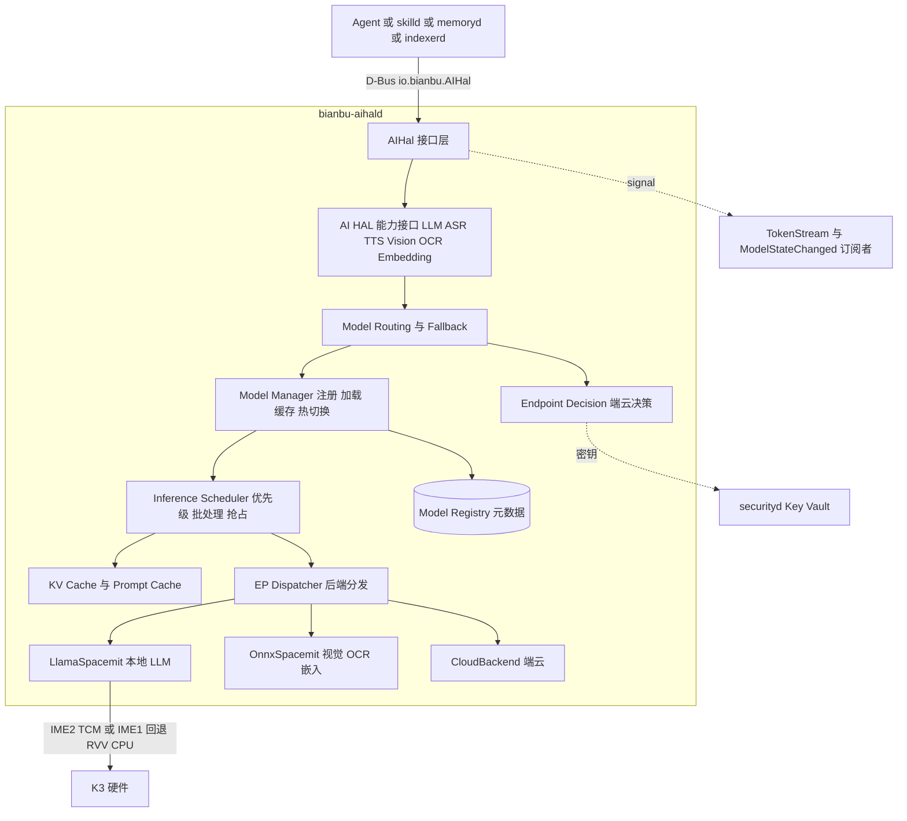

**子模块与接口映射**
| 子模块 | 接口 | 职责 |
|--------|------|------|
| AI HAL 能力层 | Generate/GenerateSync/Embed | 统一能力接口，屏蔽后端 |
| Model Manager | LoadModel/UnloadModel/SwitchModel/ListModels | 注册、单实例共享加载、缓存、热切换 |
| Inference Scheduler | （Generate 内部） | 优先级队列、动态批处理、token 边界抢占 |
| KV/Prompt Cache | （内部） | 池化 slab+LRU，公共前缀跨会话复用 |
| Endpoint Decision | SetEndpointPolicy | 隐私检测+本地置信度→本地/云路由 |
| EP Dispatcher | （内部） | 按任务类别+format 选后端 |
| 状态 | GetStatus | HAL/模型/内存状态 |
| （事件） | signal TokenStream/ModelStateChanged | 流式 token、模型态变更 |

**能力抽象 → 后端映射**（HAL 稳定，后端可插拔）
| 能力 | 本地后端（K3 定制栈） | 云后端 | Fallback |
|------|----------------------|--------|----------|
| LLM generate/embed | LlamaSpacemit(ggml-spacemit, IME/TCM) | openai/anthropic 兼容 | 本地→云（授权+隐私门控）；后端失败换链 |
| ASR | Whisper/Sherpa via onnx-spacemit | 云 ASR | 本地→云 |
| TTS | Piper | 云 TTS | 本地优先 |
| Vision/OCR/VLM | PaddleOCR/MinerU via onnx-spacemit | 云 VLM | 复杂版面→云 |
| Embedding | BGE via onnx-spacemit | 云 embed | 本地优先（隐私） |

> **算力调度**：K3 无独立 NPU → EP Dispatcher 据算子把矩阵运算下发 IME（A100=IME2+TCM，X100=IME1），未覆盖算子回退 RVV→CPU。首 token/热切换/吞吐目标见 §5 配置，[TBD-15] worker 实测锁定。

#### 3.2.2 aihald 未来扩展接口（预研，不入本期冻结契约）

| 方向 | 设想方法 | rationale | 归属 |
|------|----------|-----------|------|
| 微调/适配 | LoadAdapter / ApplyLoRA | 端侧 LoRA 适配器热加载 | 未来 |
| 多模态 | GenerateMultimodal | 图文混合输入统一入口（VLM） | 未来 |
| 批量嵌入 | EmbedBatch | 知了/索引构建批量向量化提速 | C 组需求，近期可提 |
| 量化管理 | QuantizeModel | 端侧动态量化/压缩管线 | 预研 |
| 观测 | GetInferenceMetrics | 每模型 tokens/s、首token、命中率 | bench 联动 |

### 3.3 intentd（补 d / f / g）

**d. 会话上下文状态机**
```
状态: IDLE, LISTENING, PARSING, CONTEXT_WAIT
  IDLE --Wake/Super+B--> LISTENING
  LISTENING --Transcribe 完成--> PARSING
  PARSING --有 session 上下文--> CONTEXT_WAIT(指代消解) --> IDLE
  PARSING --无上下文--> IDLE
  LISTENING --超时/取消--> IDLE
```

**f. 接口契约**
| 方法 | 输出 | 错误分支 | 超时 |
|------|------|----------|------|
| Parse | (intent∈16类, slots, conf) | conf<阈值→intent=兜底类 | 200ms |
| Transcribe | text | 音频损坏→InvalidArgument | 500ms/s 音频 |
| Speak | status=ok\|error / fd | TTS 引擎缺→Unavailable | 分句流式 |
| Wake | true | — | 立即 |

**g. 配置项**
| 参数 | 默认 | 范围 | 来源 |
|------|------|------|------|
| 意图分类阈值 | 0.6 | 0–1 | 低于→兜底类 |
| Whisper 模型 | tiny | tiny\|base\|medium\|large | 可调 |
| VAD 静音阈值 | 500ms | 200–1500ms | 可调 |
| 唤醒键 | Super+B | — | 可配 |
| 意图类数 | 16 | 固定枚举 | PRD 5.5.2.1 |

### 3.4 agent-runtimed（补 f / g；d 已在 04_LLD §3.1）

**f. 接口契约**
| 方法 | status 枚举 | 错误分支 | 超时/重试 |
|------|-------------|----------|-----------|
| Start | ok\|already_running\|denied\|error | 沙箱失败→Internal(fail-closed，不启动)；非法态→InvalidArgument | 200ms；不自动重试 |
| Pause | ok\|error | 非 RUNNING→InvalidArgument | 100ms |
| Resume | ok\|error | 非 PAUSED→InvalidArgument | 100ms |
| Stop | ok\|error | — | 200ms |
| Terminate | ok | — | 清理完整性 100% |
| Checkpoint | ckpt_id | 磁盘满→Internal | 500ms |
| Restore | ok\|error | ckpt 缺→NotFound；恢复失败→降级 INSTALLED+告警 | 2s |
| GetRuntimeInfo | info(a{sv}) | — | 只读，即时 |
| SetPriority | ok\|error | 非法优先级→InvalidArgument | 即时 |
| HealthCheck | healthy,detail | agent 不存在→NotFound | 主动探活，1s |
| WatchdogPing | ok | 未注册看门狗→InvalidArgument | Agent 定期心跳 |
| ExportCheckpoint | export_path | ckpt 缺→NotFound | 迁移用，导出便携包 |
| ImportCheckpoint | ckpt_id | 包损坏/不兼容→InvalidArgument | 迁移导入 |

> **RuntimeInfo schema（GetRuntimeInfo）**：`{version:s, api_level:i, sandbox_backends:as(bind[,overlay]), checkpoint_engine:s(criu|sdk_serialize), features:as}`。供 aicoder/SDK 探测能力集。
> **看门狗语义**：Agent 经 SDK 定期 WatchdogPing；超 `watchdog_timeout` 未 ping → runtimed 视为卡死 → 触发 Checkpoint+重启（联动 FR-RTE-10）。
> **迁移语义**：ExportCheckpoint 打包 ckpt+manifest 引用为便携文件；ImportCheckpoint 在目标机校验 SDK/模型兼容性后落地，实现「手机→PC 继续运行」的 Agent Continuity。

**g. 配置项**
| 参数 | 默认 | 范围 | 来源 |
|------|------|------|------|
| 冷启动目标 | 200ms | — | FR-RTE-02 |
| MemoryMax | 2GB | 256MB–8GB | FR-SBX-02/RTE-13 |
| CPUQuota | 100% | 10–400% | 可调 |
| IOWeight | 100 | 1–10000 | 可调 |
| ckpt 保留数 | 10 | 1–50 | FR-RTE-11 |
| 自动 ckpt 周期 | 5min | 1–60min | 可调 |
| 资源采样间隔 | 1s | 0.5–5s | FR-RTE-12 |
| 沙箱文件隔离 | bind-mount | bind\|overlay | 实机=bind（overlay 不可用） |
| Agent 优先级默认 | 0 | -20–19（nice 语义） | SetPriority |
| watchdog_timeout | 30s | 5–300s | 看门狗 |

#### 3.4.1 agent-runtimed 子系统架构（Agent OS Kernel/Supervisor）
> runtimed 是所有 Agent 的 **Supervisor**——生命周期、调度、隔离、持久化、IPC 的统一管理中心，对标 Android AMS+JobScheduler 与容器 Runtime 的融合层。**它运行 Agent，不运行 LLM**（LLM 归 aihald）。对外暴露稳定的 **Agent 抽象**，不泄露 Linux 进程细节（Start 返回状态非 PID）。

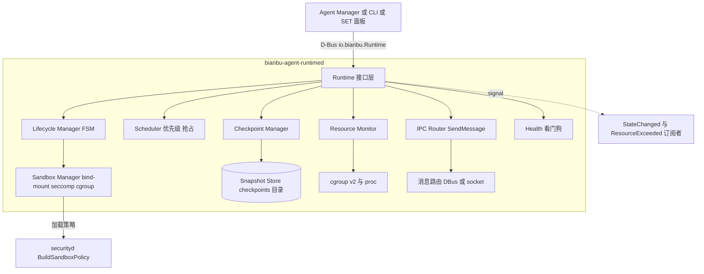

**子模块与接口映射**
| 子模块 | 接口 | 职责 |
|--------|------|------|
| Lifecycle Manager | Start/Pause/Resume/Stop/Terminate | 状态机驱动的生命周期 |
| Scheduler | SetPriority | 优先级、CPU 簇分配、抢占 |
| Checkpoint Manager | Checkpoint/Restore/ListCheckpoints/ExportCheckpoint/ImportCheckpoint | 快照、恢复、跨设备迁移 |
| Resource Monitor | GetResourceStats/ExportResourceHistory | 资源统计与历史 |
| Health | HealthCheck/WatchdogPing | 探活与看门狗（支撑崩溃恢复） |
| IPC Router | SendMessage | Agent 间受控消息路由（非直连） |
| 内省 | GetRuntimeInfo/List | Runtime 能力与 Agent 清单 |
| （事件） | signal StateChanged/ResourceExceeded | 状态与资源告警广播 |

**Agent 抽象 → Linux 实现映射**（稳定抽象层，底层可演进）
| Runtime 动作 | 当前 Linux 实现 | 未来可演进 |
|--------------|-----------------|-----------|
| Start | fork/exec + bind-mount 沙箱 | systemd-run / 容器 |
| Pause(snapshot=false) | cgroup freezer / SIGSTOP | — |
| Pause(snapshot=true) | 保存内存+上下文+队列后冻结 | CRIU dump |
| Resume | freezer thaw / SIGCONT | CRIU restore |
| Stop | SIGTERM + 优雅退出 | — |
| Terminate | SIGKILL | — |
| Checkpoint | CRIU 或 SDK 序列化状态 | 增量快照 |
| ResourceStats | cgroup v2 + /proc | eBPF/perf |
| SendMessage | D-Bus 中转 | 共享内存/MQ |

> **FSM 澄清**：Checkpoint 是 **RUNNING 上的动作（自环）**，不是独立生命周期状态；快照是产出的存储物。Restore 把某快照加载回 RUNNING。合法状态仅 INSTALLED/RUNNING/PAUSED/STOPPED/TERMINATED（+RECOVERING），见 §10.2(1) 与 04_LLD §3.1。

#### 3.4.2 agent-runtimed 未来扩展接口（预研，不入本期冻结契约）

| 方向 | 设想方法 | rationale | 归属 |
|------|----------|-----------|------|
| Scheduler | SetAffinity | 绑定 CPU 簇（A100/X100）/未来 NPU | 未来 |
| Workspace | MountWorkspace / SnapshotWorkspace | Workspace 独立生命周期（当前随 Agent） | 未来 |
| Environment | SetEnv / GetEnv | Agent 环境变量注入 | 未来 |
| Event Bus | SubscribeEvent / PublishEvent | 超越点对点的发布订阅（当前用 signal 覆盖基础广播） | 未来 |
| Debug | AttachDebugger / GetStackTrace | 运行时调试与故障诊断 | 未来 |

### 3.5 memoryd（补 f / g；回填 [TBD-4]）

**f. 接口契约**
| 方法 | status 枚举 | 错误分支 | 超时 |
|------|-------------|----------|------|
| Store | ok\|error | 越权(agent_id 不符)→PermissionDenied；容量满→淘汰后写，仍失败→Internal | 500ms |
| Get | value / 空串 | 未命中→空串（非错误） | 50ms |
| Retrieve | a(sd) 按 score 降序 | Embed 失败→Unavailable | 100ms |
| Delete/Clear | ok | — | — |

**g. 配置项**
| 参数 | 默认 | 范围 | 来源 |
|------|------|------|------|
| 单 Agent 容量上限 | 256MB | 64MB–2GB | [TBD-4] 回填=256MB |
| 淘汰策略 | LRU(last_access) | — | FR-MEM-05 |
| top_k 默认 | 5 | 1–50 | — |
| KV 存储 | SQLite WAL | — | [TBD-5]=SQLite |
| 路径 | ~/.local/share/bianbu-agents/&lt;id&gt;/memory/ | — | [TBD-6] |
| 检索目标延迟 | 100ms | — | FR-MEM-03 |

### 3.6 skilld（补 f / g）

**f. 接口契约**
| 方法 | 输出枚举 | 错误分支 | 超时 |
|------|----------|----------|------|
| Discover | aa{sv}（可空） | — | 50ms |
| Invoke | v(result) | 权限→PermissionDenied/ConfirmRequired；skill 缺→NotFound；执行超时→Timeout | skill.toml.timeout 默认 30s |
| Install | (ok, perms_to_confirm) | schema 非法→InvalidArgument；依赖缺→Unavailable | — |
| McpCall | v | 外部不可达→Unavailable | 30s |

**g. 配置项**
| 参数 | 默认 | 范围 | 来源 |
|------|------|------|------|
| Discover 目标 | 50ms | — | FR-SKL-02 |
| skill 默认超时 | 30s | 1–300s | 可 skill.toml 覆盖 |
| App fallback 总超时 | 3s | 1–10s | FR-APP-05 |
| skill 安装根 | ~/.local/share/bianbu-skills/ | — | 固定 |
| MCP endpoint 端口 | 8990 | 可配 | — |

### 3.7 indexerd（补 f / g）
**f.**（内部服务，经 Skill/Intent 暴露）：`索引构建` 幂等 upsert；`检索` 返回 `a(sd)` 片段+score；失败→Unavailable，不阻断查询主流程。
**g. 配置项**
| 参数 | 默认 | 范围 | 来源 |
|------|------|------|------|
| chunk 大小 | 512 token | 128–1024 | 可调 |
| inotify 去抖 | 2s | 0.5–10s | — |
| 新文件入索引 SLA | 10min | — | FR-VEC-07 |
| 嵌入模型 | BGE-small | — | 经 aihald（onnx-spacemit） |
| 检索目标 | 2s | — | FR-VEC-02 |

#### 3.7.1 C 组数据子系统架构（memoryd + indexerd）
> C 组管"记忆与检索"：memoryd 是 Agent 的持久记忆（分层+语义+隔离+淘汰），indexerd 是全盘文件向量索引与知了知识库。两者都**依赖 aihald.Embed 做向量化**、都用 LanceDB 存向量，但命名空间与用途分开。**它们不做推理**（推理归 aihald）。

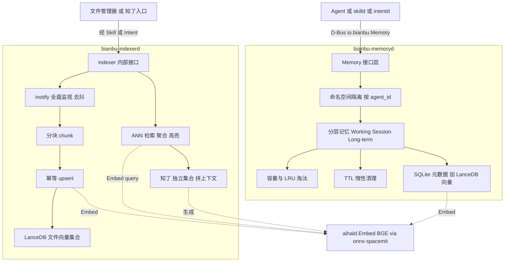

**子模块与接口映射**
| 服务 | 子模块 | 接口 | 职责 |
|------|--------|------|------|
| memoryd | 命名空间隔离 | （所有方法前置校验） | agent_id 一致性，跨命名空间→PermissionDenied |
| memoryd | 分层记忆 | Store/Get/Retrieve | Working/Session/Long-term 分层存取 |
| memoryd | 容量淘汰 | （Store 触发） | sum(bytes)>上限按 last_access LRU 淘汰 |
| memoryd | 清理 | Delete/Clear | 条目/命名空间清理，卸载联动 |
| memoryd | 备份(P2) | Backup | 登录社区账号云备份 |
| indexerd | 监视 | （inotify 内部） | create/modify/delete 增量 upsert |
| indexerd | 检索 | （经 Skill/Intent 暴露） | ANN top-k + path 聚合 + 片段高亮 |
| indexerd | 知了 | （经 Skill 暴露） | 独立集合，检索拼上下文交 aihald 生成 |

**存储布局对照**
| 用途 | 引擎 | 命名空间/表 | 隔离 |
|------|------|-------------|------|
| 记忆向量 | LanceDB | mem_&lt;agent_id&gt; | 按 Agent 物理隔离（FR-MEM-04） |
| 记忆元数据 | SQLite WAL | memory.db（agent_id,key,...） | 主键含 agent_id |
| 文件向量 | LanceDB | 全盘/指定目录集合 | 用户级，非 Agent 隔离 |
| 知了 | LanceDB | 独立知识库集合 | 用户可选建立 |

> **共性依赖**：三类向量操作（记忆写/检索、文件索引、知了）都经 aihald.Embed（BGE，onnx-spacemit 后端），Embed 失败时 memoryd 降级为仅关键字（记 warn 不阻断写），indexerd 检索失败→Unavailable 不阻断主查询。

#### 3.7.2 C 组未来扩展接口（预研，不入本期冻结契约）

| 方向 | 设想方法 | rationale | 归属 |
|------|----------|-----------|------|
| 记忆图谱 | LinkMemory / QueryGraph | 记忆间关系（实体/时间线图谱），超 KV+向量 | 未来 |
| 记忆摘要 | SummarizeSession | 会话结束自动提炼固化到 Long-term | 近期可提 |
| 混合检索 | HybridSearch | 向量+关键字+元数据过滤融合排序 | 未来 |
| 索引范围 | SetIndexScope | 用户配置纳入/排除目录 | 近期可提 |
| 重排 | Rerank | 检索后交叉编码器重排提精度 | 预研 |

---

## 4. calendard 全模块（补 GOAL 模块 8，从零）

### 4.a 职责与边界
提供日历读写与提醒。**做**：接入本地日历后端读日程、创建日程、自然语言查询转发、到点提醒（通知+可选 TTS）。**不做**：不自建日历存储引擎（复用系统后端）、不做意图解析（转 intentd）。

### 4.b 内部数据结构
```
Reminder { event_id, remind_at_ms, tts:bool, fired:bool }
reminders: MinHeap<Reminder> by remind_at_ms   # 最近到期在堆顶
EventCache { event_id, title, start_ms, end_ms, location, description }
```

### 4.c 核心算法
```
# 提醒调度（单定时线程）
loop:
  now = now_ms()
  while reminders.top().remind_at_ms <= now + 30000:   # ±30s 窗口
     r = reminders.pop()
     emit ReminderFired(r.event_id, title)
     if r.tts: intentd.Speak(title)
  sleep(min(reminders.top().remind_at_ms - now, 30000))

# 自然语言查询
ListEventsNL(text): intentd.Parse→时间范围槽位 → ListEvents(from,to)
```

### 4.d 状态机（提醒项）
```
状态: SCHEDULED, FIRED, CANCELLED
  SCHEDULED --到达 remind_at ±30s--> FIRED
  SCHEDULED --事件删除/SetReminder 取消--> CANCELLED
  FIRED --terminal--
```

### 4.e 存储布局
- 日历数据：**不自存**，经后端读写。后端选型 [TBD-8]：**建议 Evolution Data Server (EDS) via libecal**（Bianbu/LXQt 常见），备选 CalDAV。
- 提醒持久化：SQLite `~/.local/share/bianbu-calendar/reminders.db`
```sql
CREATE TABLE reminder(event_id TEXT PRIMARY KEY, remind_at_ms INTEGER,
                      tts INTEGER DEFAULT 0, fired INTEGER DEFAULT 0);
```

### 4.f 接口契约
| 方法 | 输出 | 错误分支 | 超时 |
|------|------|----------|------|
| ListEvents(from,to) | aa{sv}(Event) | 后端不可达→Unavailable | 2s |
| CreateEvent(a{sv}) | event_id | 缺 title/start→InvalidArgument；写权限→ConfirmRequired；后端失败→Unavailable | 2s |
| SetReminder(id,at,tts) | ok\|error | event 不存在→NotFound | — |
| signal ReminderFired | (event_id,title) | 触发精度 ±30s | — |

### 4.g 配置项
| 参数 | 默认 | 范围 | 来源 |
|------|------|------|------|
| 后端 | EDS(libecal) | EDS\|CalDAV | [TBD-8] |
| 提醒精度窗口 | ±30s | — | FR-CAL-04 |
| 提醒 db 路径 | ~/.local/share/bianbu-calendar/reminders.db | — | 固定 |
| 日历读/写权限等级 | L2 | — | FR-CAL-05 |

### 4.h D 组交互子系统架构（skilld + intentd + calendard）
> D 组是 Agent OS 的"交互与能力扩展面"：intentd 把语音/文本转成结构化意图，skilld 发现并调用工具（含 MCP 与 App 操控），calendard 提供日历能力。三者是**用户意图→系统能力**的落地链，都经 securityd 门控、经 aihald 推理。

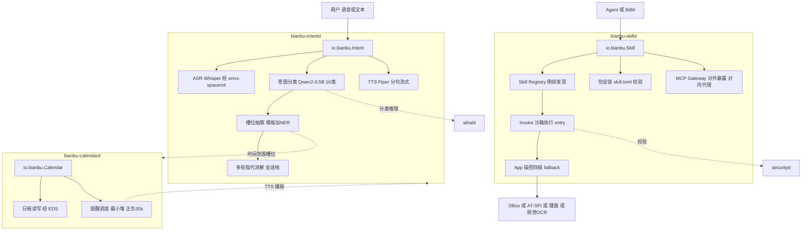

**子模块与接口映射**
| 服务 | 子模块 | 接口 | 职责 |
|------|--------|------|------|
| intentd | ASR | Transcribe | Whisper 流式转写（经 onnx-spacemit） |
| intentd | 意图分类+槽位 | Parse/ParseWithContext | 16 类分类 + 槽位抽取 + 多轮指代 |
| intentd | TTS | Speak | Piper 分句流式合成 |
| intentd | 唤醒 | Wake | Super+B / 唤醒词 |
| skilld | Registry | Register/Discover/List/SetEnabled | 倒排索引发现（≤50ms） |
| skilld | 调用 | Invoke | 权限校验→沙箱执行→审计 |
| skilld | 包管理 | Install/Uninstall | skill.toml+permissions.json 校验，semver |
| skilld | MCP 网关 | McpExpose/McpCall | 对外暴露 Skill 为 MCP 工具、对内调外部 MCP |
| skilld | App 操控 | （Invoke 内部） | DBus→AT-SPI→键盘→视觉 四级 fallback（3s 超时） |
| calendard | 日程 | ListEvents/CreateEvent | 经 EDS 读写 |
| calendard | 提醒 | SetReminder + signal ReminderFired | 最小堆调度，±30s 精度 |

**跨服务协作**
| 链路 | 说明 |
|------|------|
| intentd → aihald | 意图分类调 0.5B 模型（GenerateSync） |
| intentd → calendard | 日程类意图槽位（time_from/to）转 ListEvents |
| skilld → securityd | 每次 Invoke 前 CheckPermission，敏感操作 HITL |
| skilld → aihald | Skill 内需生成时调 Generate |
| calendard → intentd | 提醒到点可选 TTS 播报（Speak） |
| calendard → securityd | 日历写=L2 需确认 |

#### 4.i D 组未来扩展接口（预研，不入本期冻结契约）

| 服务 | 设想方法 | rationale | 归属 |
|------|----------|-----------|------|
| intentd | RegisterIntent | 第三方 Agent 自注册领域意图（超 16 类固定枚举） | 未来 |
| intentd | StreamTranscribe | 实时流式 ASR（当前整段转写） | 近期可提 |
| skilld | SkillCompose | 多 Skill 编排为复合技能 | 未来 |
| skilld | SkillMarketSync | 与社区 Skill 市场同步（绑 ECO） | ECO/未来 |
| calendard | SyncRemote | CalDAV 远程日历双向同步 | 未来 |
| calendard | RecurringEvent | 周期性日程（RRULE） | 近期可提 |

---

## 4bis. Loop Engine 与 Workspace 详细设计（补 HLD→SRS→API→LLD 断链）

> 背景：`io.bianbu.Loop` 与 Runtime 的 Workspace 方法在 HLD（BN-HLD-002 §10/§11）是一等公民，但此前未传导到 LLD。本节补齐两模块实现级设计，责任组 **B 底座（agent-runtimed）**。

### 4bis.1 Loop Engine（FR-LOOP-*）

**a. 职责与边界**
内建于 agent-runtimed Executor，驱动 Plan→Execute→Observe→Reflect→Evaluate→(Retry/Replan)→Finish 闭环。**做**：循环状态机、每步可观测事件、终止判定、HITL 暂停、护栏（防抖/防发散/预算）、崩溃续跑。**不做**：不自造推理（调 aihald）、不自造工具执行（调 skilld）、不做门禁决策（调 securityd）。

**b. 内部数据结构**
```
LoopCtx {
  loop_id, agent_id, goal, phase(enum),
  step:int, max_steps, budget_tokens, used_tokens,
  reflect_threshold:float, workflow(single|multi_agent|dag),
  last_actions: RingBuffer<action_hash>,   # 防抖检测
  last_ckpt_id, deadline_ms
}
loops: Map<loop_id, LoopCtx>
```

**c. 核心算法（循环主体）**
```
run(ctx):
  ctx.phase = PLAN
  while True:
    if terminate_check(ctx): emit LoopFinished(reason); break
    match ctx.phase:
      PLAN:    plan = Planner(ctx.goal, context);         ctx.phase=EXECUTE
      EXECUTE:
        act = next_action(plan)
        if act.risk in {L3,L4}:                           # HITL
           emit HumanGate(loop_id, act.cap); PauseLoop; return  # 等 ResumeLoop
        if dup_detect(ctx.last_actions, act): ctx.phase=REPLAN; continue  # 防抖
        result = (aihald.Generate | skilld.Invoke)(act)   # 经 securityd 门禁
        ctx.used_tokens += result.tokens; ctx.phase=OBSERVE
      OBSERVE: obs = collect(result);                     ctx.phase=REFLECT
      REFLECT:
        dev = deviation(obs, ctx.goal)
        if crashed(obs): ctx.phase=RECOVER
        elif dev > ctx.reflect_threshold: ctx.phase=REPLAN   # 防发散
        else: ctx.phase=EVALUATE
      EVALUATE:
        if goal_met(obs): emit LoopFinished(goal_met); break
        elif transient_fail(obs): ctx.phase=EXECUTE          # Retry
        else: ctx.phase=REPLAN
      REPLAN:  plan = Planner.replan(ctx, obs);             ctx.phase=EXECUTE
      RECOVER: Runtime.Restore(agent_id, ctx.last_ckpt_id); ctx.phase=PLAN
    ctx.step += 1
    emit LoopStep(loop_id, ctx.phase, ctx.step)
    if ctx.step % ckpt_every == 0: ctx.last_ckpt_id = Runtime.Checkpoint(agent_id)

terminate_check(ctx): 达成 | step>max_steps | used_tokens>budget | now>deadline | cancelled
```

**d. 循环状态机**（对齐 HLD §11.1，实现级）
```
状态: PLAN, EXECUTE, OBSERVE, REFLECT, EVALUATE, REPLAN, RETRY, RECOVER, HUMAN_GATE, FINISHED
  PLAN→EXECUTE→OBSERVE→REFLECT→EVALUATE
  EVALUATE→FINISHED(达成) | EVALUATE→RETRY→EXECUTE(瞬时失败) | EVALUATE→REPLAN→PLAN(未达成)
  EXECUTE→HUMAN_GATE(L3/L4)；HUMAN_GATE→EXECUTE(批准) | HUMAN_GATE→FINISHED(拒绝/取消)
  REFLECT→RECOVER(崩溃)→PLAN(从 Checkpoint)
  任意→FINISHED(超步数/超预算/超时/取消/不可恢复)
```

**f. 接口契约**
| 方法 | 输出枚举 | 错误分支 | 超时 |
|------|----------|----------|------|
| StartLoop | loop_id | goal 空→InvalidArgument；Agent 非 RUNNING→InvalidArgument | 立即返回，循环异步跑 |
| PauseLoop | ok\|error | loop 不存在→NotFound | 100ms |
| ResumeLoop | ok\|finished | approved=false→LoopFinished(cancelled) | 100ms |
| CancelLoop | ok | — | 200ms |
| GetLoopState | a{sv}(phase,step,used_tokens) | 不存在→NotFound | — |

**g. 配置项**
| 参数 | 默认 | 范围 | 来源 |
|------|------|------|------|
| loop.max_steps | 40 | 1–500 | FR-LOOP-03 |
| loop.budget_tokens | 100000 | 1k–1M | FR-LOOP-03/联动 SEC-04 |
| loop.reflect_threshold | 0.5 | 0–1 | FR-LOOP-05 防发散 |
| loop.ckpt_every | 5 步 | 1–50 | FR-LOOP-02/联动 RTE-07 |
| loop.dedup_window | 8 | 1–32 | FR-LOOP-05 防抖 |
| loop.default_timeout | 300s | 10–3600s | FR-LOOP-03 |

### 4bis.2 Workspace Manager（FR-WS-*，并入 Runtime）

**a. 职责与边界**
runtimed 的 Workspace Manager，与 Sandbox Manager 协同。**做**：私有工作区挂载（bind-mount）、文件快照/回滚（与进程 Checkpoint 一致）、artifacts 管理、inotify 变更增量索引。**不做**：不自建向量索引（转 indexerd）、不做进程状态快照（那是 Checkpoint/CRIU）。

**b. 内部数据结构**
```
Workspace { agent_id, root, ro_deps:[path], rw:path, artifacts:path,
            snapshots:[{snap_id, ts, method(git|copy), ckpt_id}] }
```
> 与 04_LLD §3.2 沙箱 Start 路径共用私有根 `~/.local/share/bianbu-agents/<id>/`；Workspace=其中 rw+artifacts+memory 的视图管理。

**c. 核心算法**
```
MountWorkspace: mkdir 私有根 → bind-mount rw → bind-mount -o ro 依赖 → 返回 root
SnapshotWorkspace(label):
  同刻: snap = git commit(rw) 或 文件复制快照
        ckpt = Runtime.Checkpoint(agent_id)   # 进程态
        记录 {snap_id, ckpt_id} 配对 → 一致快照
RollbackWorkspace(snap_id):
  git reset --hard snap 或 复制还原 rw
  若有配对 ckpt: Runtime.Restore(agent_id, ckpt_id)  # 文件+进程一致回滚
File Watch: inotify(rw) create/modify/delete → 去抖 → indexerd 增量 upsert
```

**d. 快照状态机**
```
状态: MOUNTED, SNAPSHOTTED, ROLLED_BACK
  (无)→MOUNTED(MountWorkspace)
  MOUNTED→SNAPSHOTTED(SnapshotWorkspace，可多次)
  SNAPSHOTTED→ROLLED_BACK(RollbackWorkspace)→MOUNTED
```

**f. 接口契约**（方法在 io.bianbu.Runtime）
| 方法 | 输出 | 错误分支 | 超时 |
|------|------|----------|------|
| MountWorkspace | root_path | 磁盘满→Internal；已挂载→返回现有 | 100ms（含沙箱预算内） |
| SnapshotWorkspace | snap_id | git/复制失败→Internal | 500ms（与 ckpt 对齐） |
| RollbackWorkspace | ok\|error | snap 缺→NotFound；ckpt 恢复失败→降级告警 | 2s |
| ListArtifacts | aa{sv} | — | — |
| ExportArtifact | export_path | 路径越界→PermissionDenied | — |

**g. 配置项**
| 参数 | 默认 | 范围 | 来源 |
|------|------|------|------|
| ws.snapshot_method | git | git\|copy | FR-WS-02 |
| ws.artifacts_dir | artifacts/ | — | FR-WS-04 |
| ws.inotify_debounce | 2s | 0.5–10s | FR-WS-03/复用 indexer |
| ws.fs_isolation | bind-mount | bind\|overlay | 实机=bind（同沙箱） |
| ws.code_graph | off | on\|off | FR-WS-06（P2） |

---

## 5. 集中配置清单（补 GOAL 3.5，消灭散落 magic number）

单一权威表；各服务从 `/etc/bianbu/config.toml` 加载，键名 `<service>.<param>`。范围外值启动即拒绝并告警。

| 键 | 默认 | 范围 | 单位 | 责任组 | TBD |
|----|------|------|------|--------|-----|
| security.audit_segment_size | 64 | 16–256 | MB | B | — |
| security.confirm_timeout | 60 | 10–300 | s | B | — |
| security.token_metering | prompt_completion | prompt_completion\|completion_only | — | B | TBD-2=双向 |
| security.token_limit_per_conversation | 100000 | 1000–2000000 | token | B | FR-SEC-04 |
| security.token_limit_per_day | 500000 | 10000–20000000 | token | B | FR-SEC-04 |
| security.local_infer_counts_budget | false | true\|false | — | B | TBD-3=否 |
| aihal.batch_window | 10 | 0–50 | ms | A | — |
| aihal.batch_max_size | 8 | 1–32 | — | A | — |
| aihal.kv_pool_ratio | 0.40 | 0.10–0.70 | 占内存比 | A | — |
| aihal.preempt_granularity | 100 | — | ms | A | FR-AI-08 |
| aihal.local_confidence_threshold | 0.85 | 0–1 | — | A | FR-AI-18 |
| aihal.first_token_target | 200 | — | ms | A | TBD-15 实测 |
| aihal.switch_model_target | 2000 | — | ms | A | TBD-15 |
| aihal.load_timeout | 30 | — | s | A | — |
| runtime.cold_start_target | 200 | — | ms | B | FR-RTE-02 |
| runtime.memory_max | 2048 | 256–8192 | MB | B | FR-SBX-02 |
| runtime.cpu_quota | 100 | 10–400 | % | B | — |
| runtime.io_weight | 100 | 1–10000 | — | B | — |
| runtime.ckpt_retain | 10 | 1–50 | 个 | B | FR-RTE-11 |
| runtime.ckpt_interval | 300 | 60–3600 | s | B | — |
| runtime.resource_sample | 1 | 0.5–5 | s | B | FR-RTE-12 |
| runtime.sandbox_fs | bind | bind\|overlay | — | B | 实机=bind |
| memory.capacity_per_agent | 256 | 64–2048 | MB | C | TBD-4=256 |
| memory.top_k_default | 5 | 1–50 | — | C | — |
| memory.retrieve_target | 100 | — | ms | C | FR-MEM-03 |
| intent.classify_threshold | 0.6 | 0–1 | — | D | — |
| intent.asr_model | tiny | tiny\|base\|medium\|large | — | D | — |
| intent.vad_silence | 500 | 200–1500 | ms | D | — |
| intent.parse_target | 200 | — | ms | D | FR-INT-04 |
| skill.default_timeout | 30 | 1–300 | s | D | — |
| skill.app_fallback_timeout | 3 | 1–10 | s | D | FR-APP-05 |
| skill.discover_target | 50 | — | ms | D | FR-SKL-02 |
| skill.mcp_port | 8990 | 1024–65535 | — | D | — |
| indexer.chunk_size | 512 | 128–1024 | token | C | — |
| indexer.inotify_debounce | 2 | 0.5–10 | s | C | — |
| indexer.index_sla | 600 | — | s | C | FR-VEC-07 |
| indexer.retrieve_target | 2 | — | s | C | FR-VEC-02 |
| calendar.backend | eds | eds\|caldav | — | D | TBD-8=eds |
| calendar.reminder_window | 30 | — | s(±) | D | FR-CAL-04 |
| voice.e2e_target | 1500 | — | ms | D | FR-ASR-04 |
| loop.max_steps | 40 | 1–500 | 步 | B | FR-LOOP-03 |
| loop.budget_tokens | 100000 | 1000–1000000 | token | B | FR-LOOP-03 |
| loop.reflect_threshold | 0.5 | 0–1 | — | B | FR-LOOP-05 |
| loop.ckpt_every | 5 | 1–50 | 步 | B | FR-LOOP-02 |
| loop.dedup_window | 8 | 1–32 | — | B | FR-LOOP-05 |
| loop.default_timeout | 300 | 10–3600 | s | B | FR-LOOP-03 |
| ws.snapshot_method | git | git\|copy | — | B | FR-WS-02 |
| ws.inotify_debounce | 2 | 0.5–10 | s | B | FR-WS-03 |
| ws.fs_isolation | bind | bind\|overlay | — | B | FR-WS-01 |
| ws.code_graph | off | on\|off | — | B | FR-WS-06 |

---

## 6. 时序补全（补 GOAL 4.3 / 4.4）

### 6.1 沙箱启动关键路径（4.3，各步时间预算，总 ≤200ms）
| 步 | 动作 | 预算 | 说明 |
|----|------|------|------|
| 1 | Security.BuildSandboxPolicy（生成 seccomp+netfilter 规则，**与2/3并行预取**） | 20ms | 模板缓存命中更快；输出供步骤4/5消费 |
| 2 | 准备文件根（bind-mount 私有根 + 只读依赖） | 40ms | 无 overlay COW 开销 |
| 3 | cgroup v2 写限额（CPUQuota/MemoryMax/IOWeight） | 15ms | 预创建 cgroup 模板复用 |
| 4 | netfilter 白名单下发 | 15ms | 默认 DROP |
| 5 | execve 前 cap drop + seccomp_load | 10ms | fork 后 execve 前 |
| 6 | 注入 SDK runtime → on_start | 80ms | 主要耗时，SDK 初始化 |
| 7 | FSM=RUNNING + AuditLog(异步) | 5ms | 审计异步不阻塞 |
| — | **合计（1∥2∥3 并行 → 4+5+6+7 串行）** | **≤200ms** | 步骤4依赖步骤1输出；全串行185ms仍达标；[TBD-15] worker 实测锁定 |
> 失败任一步 → 回滚已建资源、拒绝启动、SecurityAlert（fail-closed，FR-SBX-07）。

### 6.2 崩溃恢复 / Checkpoint 时序（4.4）
```
runtimed 监控线程: waitpid(agent_pid)
 进程异常退出(exit≠0 / 信号):
   1. StateChanged(RUNNING→RECOVERING)
   2. ckpt = ListCheckpoints(agent_id).latest
   3. if ckpt 存在:
        Restore(agent_id, ckpt.id)         # 重建沙箱+载入状态, 目标 2s
        成功: StateChanged(RECOVERING→RUNNING); AuditLog("crash_recovered")
        失败(重试1次仍失败):
          降级: StateChanged(RECOVERING→INSTALLED)
          SecurityAlert(agent_id,"recover_failed"); 通知用户
      else:
        无 ckpt → 降级 INSTALLED + 告警
 恢复成功率目标 ≥95%（FR-RTE-10）
```
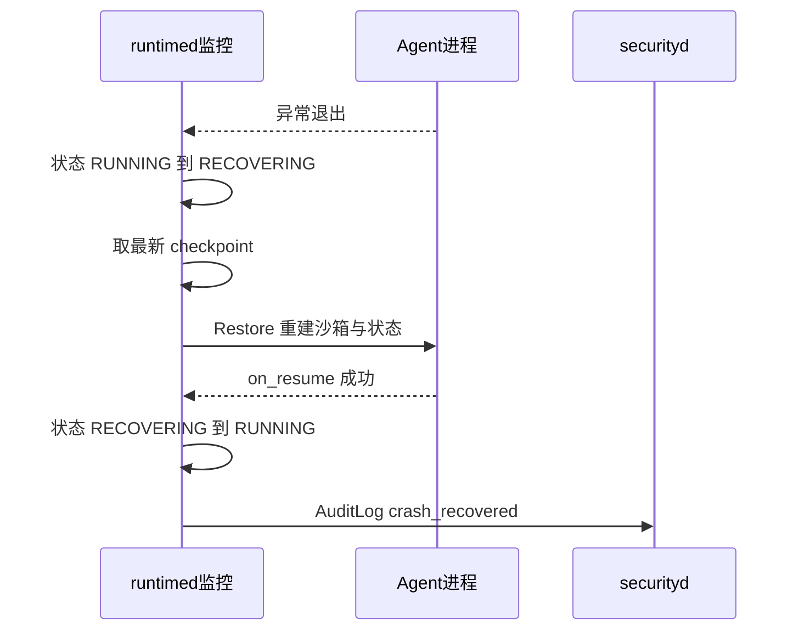

---

## 7. FR→测试点映射（补 GOAL 第五部分，aicoder 验收锚点）

每条可自动判定，禁止"功能正常"。格式：输入 → 预期输出/度量。

### 7.1 FR 验收测试点（关键 P0/P1）
| FR | 测试点（输入 → 预期） | 判定 |
|----|----------------------|------|
| FR-SEC-01 | 装无 manifest 包 → 拒绝+reason；装 L4 能力包 → 标记强制二次确认 | 断言拒绝码/标记 |
| FR-SEC-03 | Agent 调 L3 能力未确认 → 操作阻断(decision=1) | 断言未执行 |
| FR-SEC-04 | 单会话累计=100001 token → within=false + TokenExceeded/SecurityAlert；Agent Runtime/agent 消费后暂停或终止 | 断言 QuotaExceeded、事件和状态 |
| FR-SEC-06 | 写 3 条审计后篡改第 2 条 → VerifyAuditChain=false 且定位=2 | 断言 intact=false |
| FR-SBX-01 | Agent 读 scope 外路径 → EACCES/拦截 | 断言拦截率 100% |
| FR-SBX-07 | 注入沙箱构建失败 → Start 返回 error 且 Agent 不 RUNNING | 断言状态≠RUNNING |
| FR-AI-02 | 同模型第 2 次 LoadModel → 延迟 ≤首次×0.2 | 断言延迟降 ≥80% |
| FR-AI-10 | 7B GGUF Generate → 首 token ≤200ms（worker 实测） | 度量首 token [TBD-15] |
| FR-AI-19 | 含联系人路径任务 → route=LOCAL | 断言不上云，准确率 ≥99% |
| FR-RTE-02 | Start → 冷启动 ≤200ms | 度量 wall time |
| FR-RTE-10 | kill -9 Agent → ≤2s 内 Restore 回 RUNNING | 100 次成功率 ≥95% |
| FR-RTE-13 | Agent 占用 >2GB → 自动 Pause+通知 | 断言状态+ResourceExceeded |
| FR-MEM-03 | Retrieve(query,5) → ≤100ms 返回 top-5 | 度量延迟+人工命中率 ≥80% |
| FR-MEM-04 | Agent A 读 Agent B 记忆 → PermissionDenied | 断言拦截 100% |
| FR-INT-01 | 800 条标注集 Parse → top-1 ≥90% | 批量准确率 [TBD-10] |
| FR-ASR-04 | 录音结束→反馈 → ≤1.5s | 端到端打点 |
| FR-SKL-02 | Discover(query) → ≤50ms | 度量延迟 |
| FR-CAL-04 | SetReminder(t) → 在 t±30s 触发 ReminderFired | 断言触发时刻误差 |
| FR-VEC-07 | 新建文件 → ≤10min 可检索到 | 断言索引延迟 |

### 7.2 算法分支测试点
| 算法 | 分支 | 输入 → 预期 |
|------|------|-------------|
| securityd.check | REVOKED | 已撤销 cap → DENY(2) |
| | L4 | 任意 L4 → CONFIRM(1) 即使 trusted |
| | once+已缓存 | SESSION_TRUSTED → ALLOW(0) |
| | once+未缓存 | GRANTED once → CONFIRM(1) |
| | trusted L2 | → ALLOW(0) |
| aihal.route | privacy 命中 | 含敏感 → LOCAL |
| | conf≥0.85 | 高置信 → LOCAL |
| | conf<0.85+授权 | → CLOUD |
| | conf<0.85+未授权 | → LOCAL(best-effort) |
| calendar 提醒 | 到期窗口 | remind_at≤now+30s → FIRED |

### 7.3 FSM 转换测试点（B 组）
| FSM | 合法 | 非法（须拒绝） |
|-----|------|----------------|
| Lifecycle | INSTALLED→RUNNING(Start) | INSTALLED→PAUSED（拒绝，InvalidArgument） |
| | RUNNING→PAUSED→RUNNING | STOPPED→PAUSED（拒绝） |
| | RUNNING→RECOVERING→RUNNING | TERMINATED→任何（拒绝） |
| 权限态 | GRANTED→SESSION_TRUSTED | UNDECLARED→GRANTED（拒绝，须先 DECLARED） |
| 模型态 | LOADED→CACHED→LOADED | UNLOADED→CACHED（拒绝） |
| Loop 态 | EVALUATE→FINISHED(达成) / EXECUTE→HUMAN_GATE(L4) | FINISHED→任何（拒绝，terminal） |

### 7.3bis Loop 算法测试点（补 FR-LOOP-*）
| 场景 | 输入 → 预期 |
|------|-------------|
| 终止-超步数 | step>max_steps → LoopFinished(max_steps) |
| 终止-超预算 | used_tokens>budget → LoopFinished(budget) |
| HITL | Execute 命中 L4 → HumanGate 发出且暂停；ResumeLoop(false)→LoopFinished(cancelled) |
| 防抖 | 连续重复 action → 转 REPLAN，不重复执行 |
| 防发散 | deviation>reflect_threshold → 转 REPLAN |
| 崩溃续跑 | 循环中 Agent 崩溃 → RECOVER→从 ckpt→PLAN 续跑，成功率 ≥95% |
| WS 一致回滚 | Snapshot 后改文件+推进状态 → Rollback → 文件与进程态同步还原 |

### 7.4 集成测试场景（端到端，E 组汇总）
| 场景 | 链路 | 通过条件 |
|------|------|----------|
| IT-1 语音记事 | 语音→intent→skill→memory.Store→TTS 确认 | 记忆可 Retrieve 回，端到端 ≤1.5s |
| IT-2 文档问答 | "找X文档"→indexer 检索→aihal 生成→响应 | 命中正确文档，检索 ≤2s |
| IT-3 敏感操作门禁 | Agent 删文件→CheckPermission→HITL 确认→执行→审计 | 未确认不删；审计链含该条 |
| IT-4 崩溃恢复 | 运行中 kill→自动 Restore→继续 | ≤2s 回 RUNNING，上下文保留 |
| IT-5 端云路由 | 超长上下文→route=CLOUD（已授权）→透明返回 | 用户无感知 ≤1s 切换 |
| IT-6 循环任务 | StartLoop(多步目标)→Plan/Execute/Reflect 迭代→Finish | 达成终止，LoopStep 事件完整，超预算即止 |
| IT-7 工作区回滚 | Agent 改代码→SnapshotWorkspace→出错→RollbackWorkspace | 文件+进程态一致回滚，无残留 |

---

## 8. 剩余 TBD 回填（补 GOAL 6.5）

| TBD | 结论（本文件回填） | 责任组 |
|-----|-------------------|--------|
| TBD-2 token 计量口径 | **prompt+completion 双向计数**（security.token_metering=prompt_completion） | B |
| TBD-3 本地推理计入预算 | **否**（仅云端计入；security.local_infer_counts_budget=false） | B |
| TBD-4 记忆容量默认 | **256MB/Agent**（memory.capacity_per_agent） | C |
| TBD-8 Calendar 后端 | **EDS(libecal) 优先，CalDAV 备选**（calendar.backend=eds） | D |
| TBD-10 意图测试集 | **每类 ≥50 条、共 ≥800 条标注集**；由 D 组+PM 提供语料，top-1 ≥90% | D/PM |
| TBD-11 AI-14 与 INT-01 口径 | **INT-01 用 16 类线上意图集(≥90%)；AI-14 任务类型分类为预研另立集(≥95%)，二者独立不混用** | A/D |
| TBD-18 BIT-42 引用 | **删除**（原 PRD 5.5.8.3 误引，改引 ECO-05） | E |
| TBD-9 Level2 命名空间 | **Phase2 纳入**（runtime.sandbox_fs 增 ns，本阶段 bind 为主） | B |

仍需产品/硬件确认（非本文件可定）：**[TBD-15] 性能 baseline**（须 worker 实测）、K5/K7 规格、TEE（已定无→软方案）。

---

## 9. 完成度对账（对 GOAL 清单）
| GOAL 缺口 | 本文件补全位置 | 完成度 |
|-----------|----------------|--------|
| 0.3 全局约定 / 0.4 术语 | §0 | ✅ |
| 各模块 d（securityd/aihald/intentd） | §3.1/3.2/3.3 | ✅ |
| 各模块 f/g（全 8 模块） | §3 + §4（calendard） | ✅ |
| calendard 全 7 项 | §4 | ✅ |
| 2.1 D-Bus introspection XML（7/7 接口） | §2.1–2.4（本次补全 Memory/Skill/Intent/Calendar） | ✅ |
| 2.2 所有 a{sv} 数据 schema | §2.5（本次补全 SkillManifest/IntentSlots/ModelEntry/CheckpointEntry） | ✅ |
| 2.3 调用矩阵 / 2.4 错误矩阵 | §2.6 / §2.7 | ✅ |
| 3.5 集中配置清单（含 token 会话/日上限） | §5（本次补 security.token_limit_per_conversation/per_day） | ✅ |
| 4.3 沙箱时间预算（并行逻辑修正） | §6.1（本次修正 1∥2∥3→4+5+6+7） | ✅ |
| 4.4 崩溃恢复时序 | §6.2 | ✅ |
| 5.1–5.4 测试点映射 | §7 | ✅ |
| 6.5 剩余 TBD 回填 | §8 | ✅ |
| **HLD→SRS→API→LLD 断链补全（Loop Engine / Workspace）** | §4bis + SRS 3.3.1/3.3.2 + API §4bis/Runtime + §5/§7 | ✅ |

> 与 `04_Bianbu_Next_LLD.md` 合读即为完整 aicoder-ready LLD。开工前仍需：完整文档链 TBD 全回填（[TBD-15] 待实测）、机器可读契约落地为 `.xml`/DDL 文件、测试骨架搭建（对齐 GOAL 附录）。

---

## 10. 实现级图集（LLD 职责，双轨补图给评审）

> 说明：以下 mermaid 图与前文表格/伪代码**等价并存**——前文表/伪代码是 aicoder 的机器可读源，本节图供人工评审看清并发/往返/分支。**总体与子系统架构不在此**（见 HLD BN-HLD-002）。GitLab 兼容：标签内不含 `:` `/` `()` 等字符。

### 10.1 时序图（对应前文文字时序）

**（1）流式生成（对应 04_LLD §2.6）**
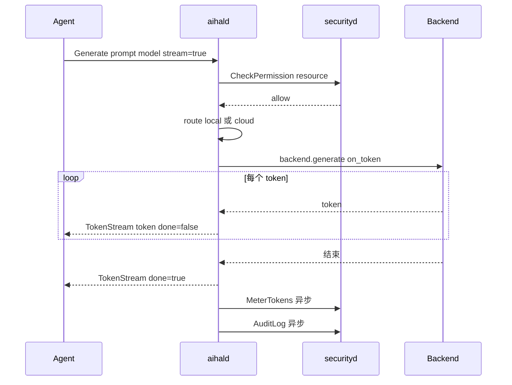

**（2）语音端到端（对应 04_LLD §9，目标 ≤1.5s）**
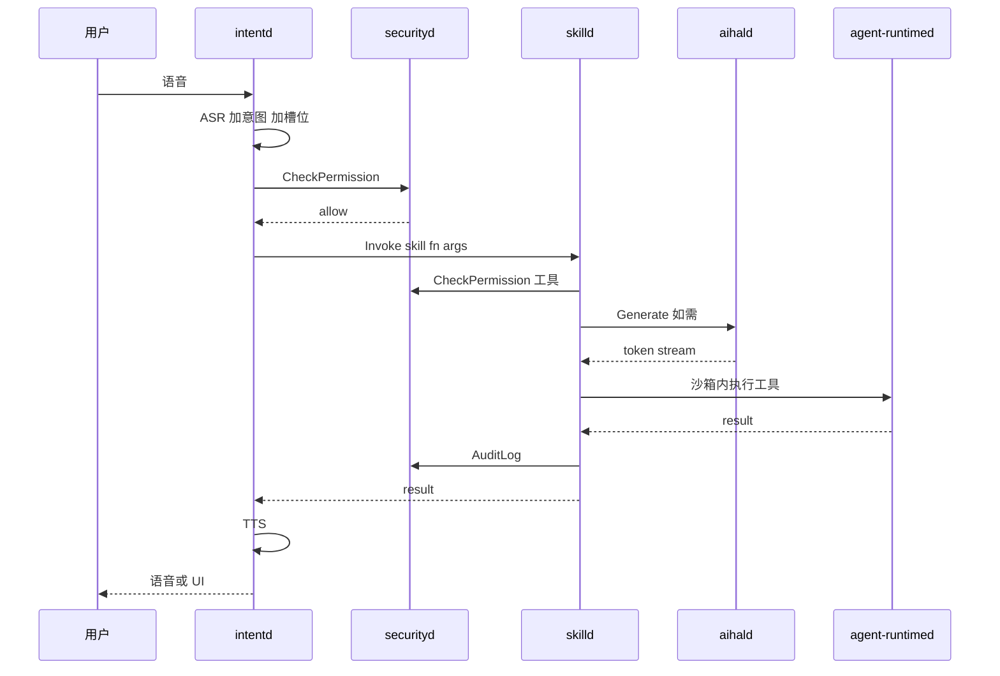

**（3）沙箱启动关键路径（对应 §6.1，总 ≤200ms）**
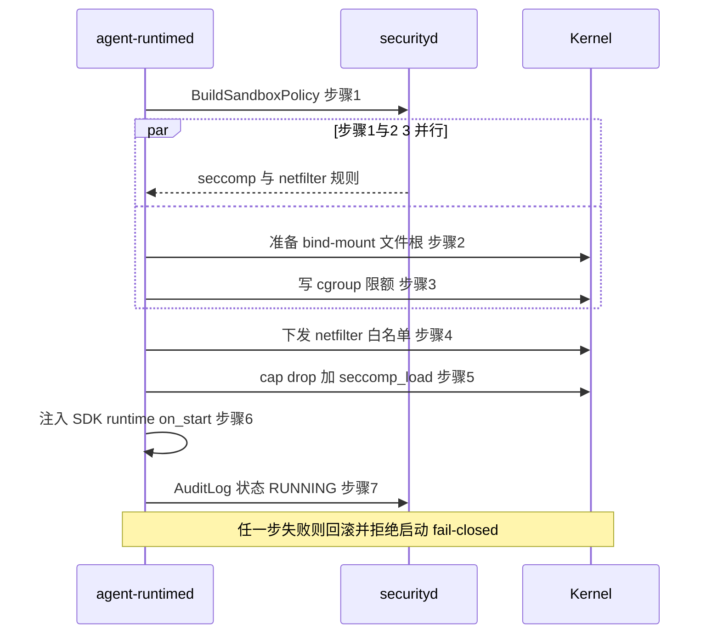

**（4）敏感操作门禁 HITL（对应 IT-3）**
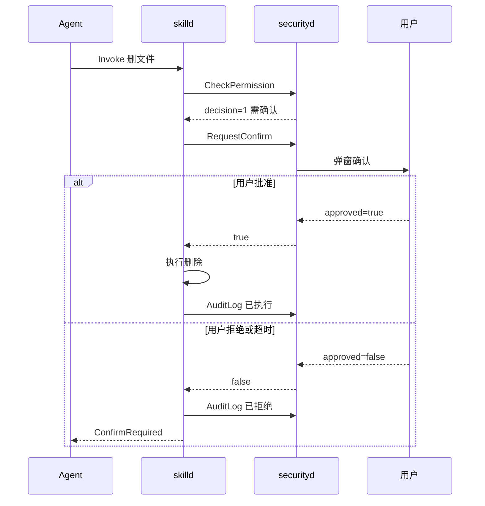

### 10.2 状态机图（对应各模块 d 项的转换表）

**（1）Agent Lifecycle FSM（对应 04_LLD §3.1）**
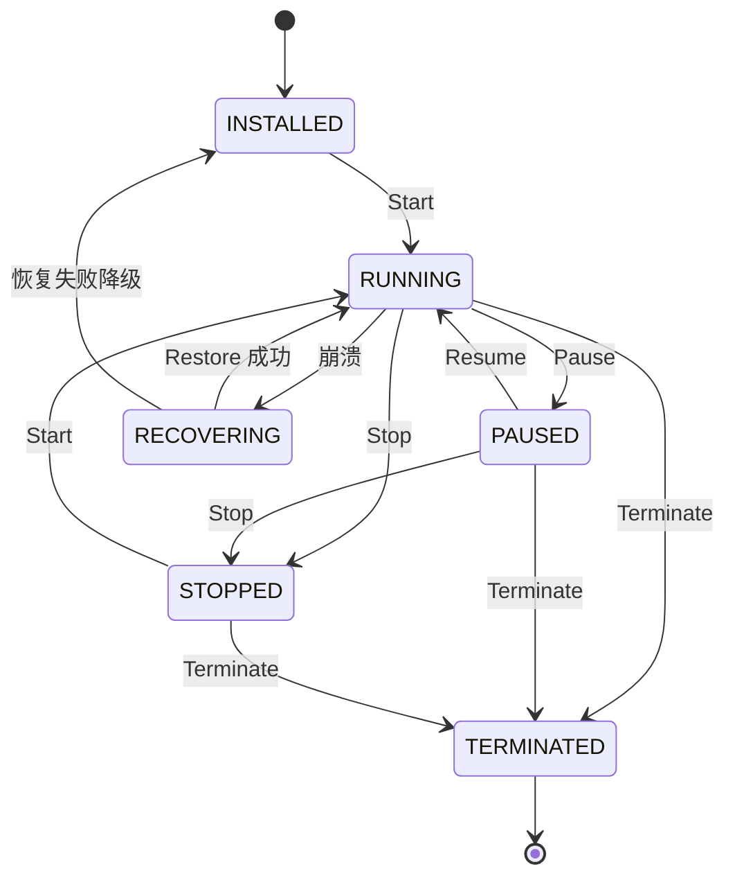

**（2）权限决策态（对应 §3.1）**
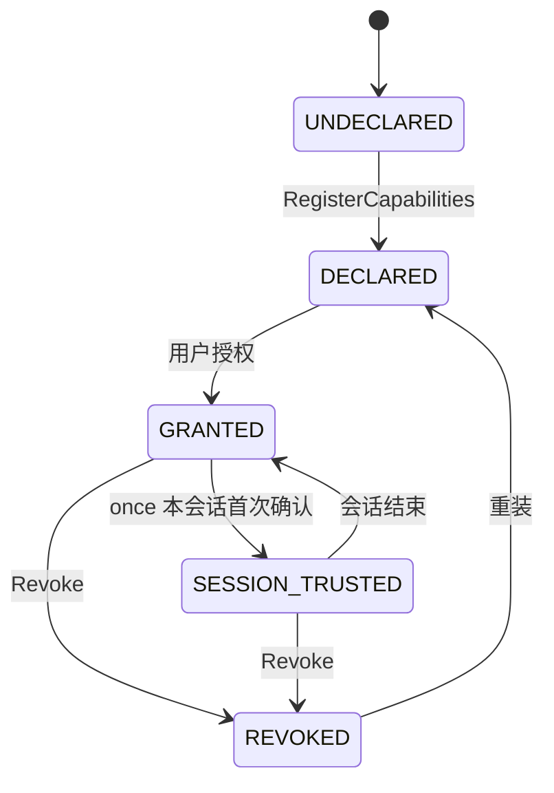

**（3）模型实例态（对应 §3.2）**
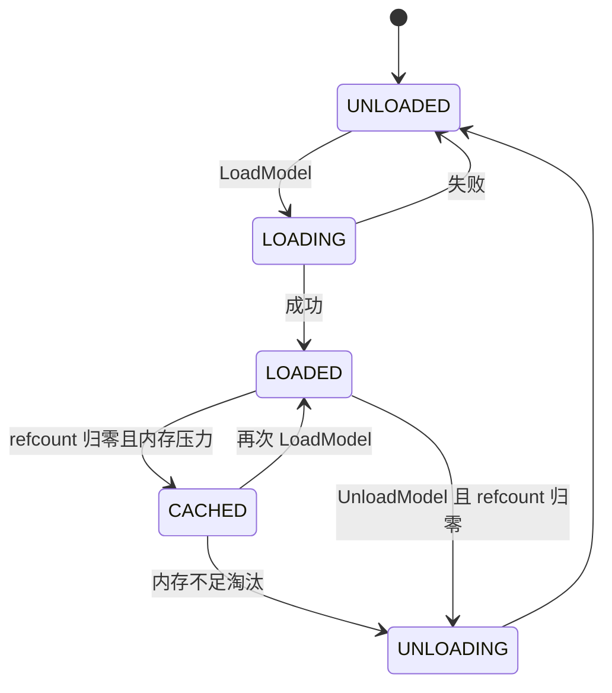

**（4）会话上下文态（对应 §3.3）**
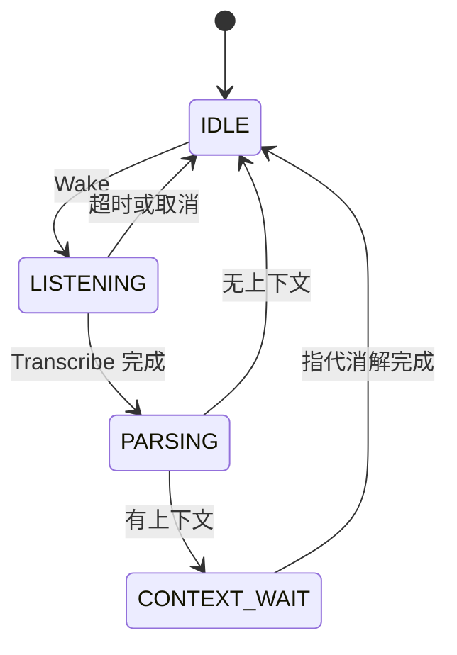

**（5）提醒项态（对应 §4.d）**
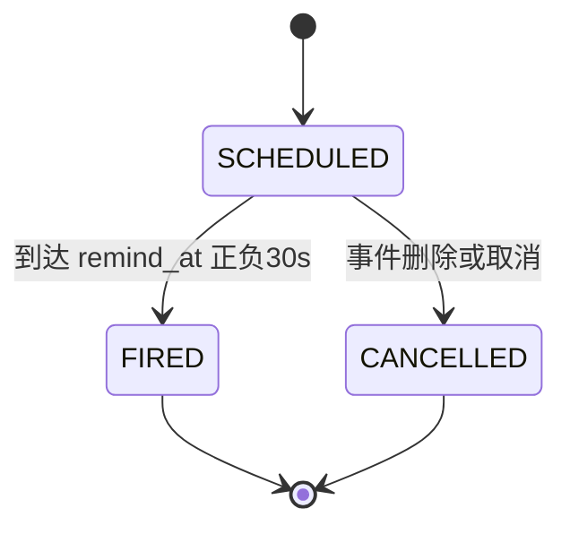

### 10.3 算法流程图（对应关键伪代码）

**（1）权限决策 check（对应 04_LLD §1.1）**
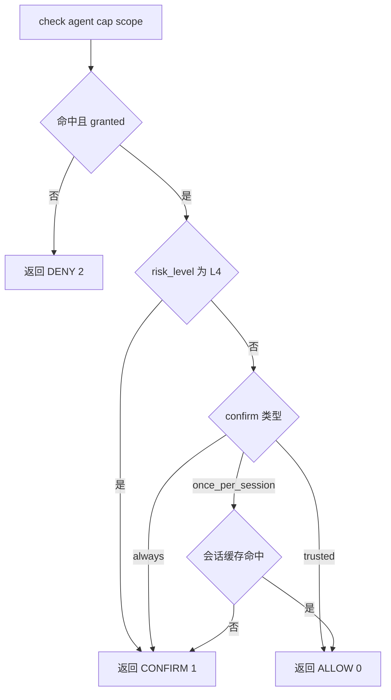

**（2）端云路由 route（对应 04_LLD §2.5）**
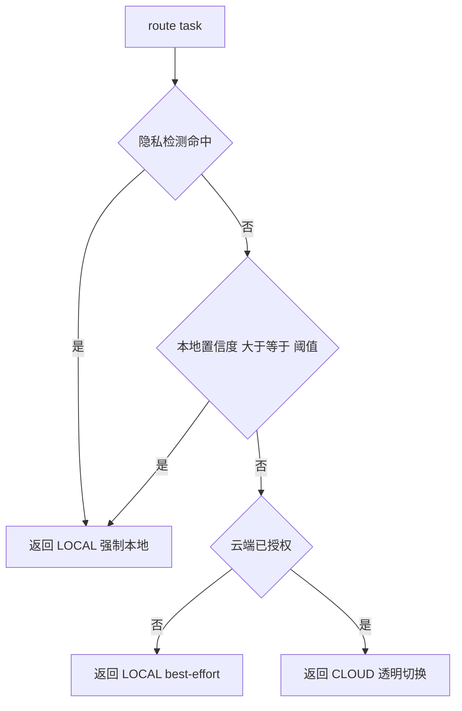

**（3）App 操控四级 Fallback（对应 04_LLD §6.4）**
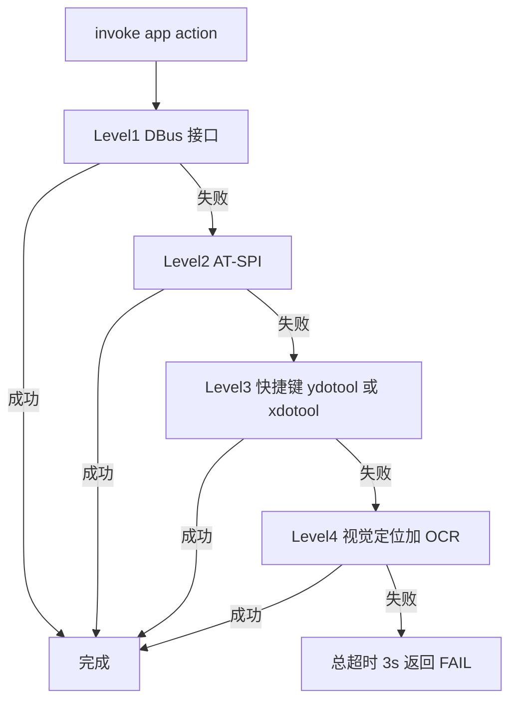

> 图集覆盖：时序 4 张（流式生成/语音端到端/沙箱启动/门禁）、状态机 5 张（Lifecycle/权限/模型/会话/提醒）、算法流程 3 张（check/route/App fallback）。均与前文表格/伪代码等价，评审看图、aicoder 读表。

---
*BN-LLD-002 V1.0 · 补全 BN-LLD-001 至 aicoder-ready · 依 BN-LLD-GOAL-001。内容由 AI 辅助生成。*


