# Bianbu Next Agent OS — 企业级 High Level Design（HLD）

| 项 | 内容 |
|----|------|
| 文档编号 | BN-HLD-002 |
| 版本 | V1.0 |
| 来源 | 基于 SRS（BN-SRS-001）+ 概要设计（BN-HLD-001，含 worker 实测校准）+ PRD V0.9 |
| 日期 | 2026-07-07 |
| 状态 | 待评审 |
| 定位 | Agent OS / Agent Framework / Agent Runtime / AI Runtime / AI HAL 全平台 HLD，可直接作为 LLD、接口设计与研发实施基础 |

> 约定：本文件每个子系统按 **Why（为什么存在）/ What（提供什么能力）/ How（如何实现）/ Interaction（如何协作）** 四问展开，附 Mermaid 图。硬件事实以 worker（10.0.90.243，SpacemiT K3：A100+X100 riscv64、RVV+fp16 向量、无独立 NPU、无 TEE、31GB 统一内存、Bianbu 4.0.1）实测为准。实现遵循 AGENTS.md 复用边界：全栈自研，不复用 agentforce/hermes。

---

## 一、为什么这样设计（Architecture Vision）

### 1.1 系统定位
Bianbu Next 是**面向 RISC-V + AI 的 AI-Native Agent 操作系统底座**：不是在传统 OS 之上叠一层 AI SDK，而是把 **Agent 作为第一类执行单元（first-class citizen）**，将推理、记忆、工具、安全、调度沉淀为操作系统级常驻服务，让任意 Agent 在其上获得"原生般"的运行、隔离、持久与可观测能力。

### 1.2 设计目标
| 目标 | 度量（源自 SRS NFR） |
|------|----------------------|
| AI 能力原生化 | 本地推理首 token ≤200ms（目标值，K3 baseline 锁定）；模型单实例共享二次调用延迟↓≥80% |
| Agent 轻量高并发 | 冷启动 ≤200ms，空闲内存 ≤50MB/Agent |
| 安全内生可审计 | 权限越权拦截 100%，审计哈希链可验证 100% |
| 持久与可恢复 | 崩溃恢复成功率 ≥95%，7 天长运行无泄漏 |
| 本地优先隐私 | 隐私任务强制本地（检测 ≥99%），云端为授权增强 |
| 开放可扩展 | 新 Agent/Skill/Tool/Backend/Provider 插件式接入，不改核心 |

### 1.3 AI Native 理念
传统"应用 = 代码 + 数据"；AI-Native 下 **"Agent = 目标 + 上下文 + 工具 + 循环"**。系统据此重排优先级：
- **推理是系统调用**：模型推理如同 syscall，由 AI Runtime 统一供给，Agent 不自带模型。
- **上下文是一等资源**：Memory/Context 像内存管理一样被调度、压缩、淘汰（Context Engineering）。
- **循环是执行模型**：Agent 以 Plan-Execute-Observe-Reflect 闭环运行（Loop Engine），而非一次性函数调用。
- **工具是能力扩展点**：Tool/Skill 如同设备驱动，经 Registry 发现、经 Capability 授权。

### 1.4 Agent OS 与传统 OS 的区别
| 维度 | 传统 OS | Bianbu Next Agent OS |
|------|---------|----------------------|
| 执行单元 | 进程/线程 | Agent（含目标、记忆、生命周期） |
| 核心调度 | CPU 时间片 | CPU + AI 算力 + 上下文预算 联合调度 |
| 系统调用 | 文件/网络/进程 | + 推理/嵌入/检索/工具调用 |
| IPC | pipe/socket/信号 | D-Bus 系统总线 + 事件流 + MCP |
| 隔离 | 用户/进程 | 沙箱 + Capability + 审计链 + 上下文隔离 |
| 状态 | 进程内存 | 可 Checkpoint/Restore 的 Agent 状态 + 持久记忆 |
| 交互 | GUI/CLI | 自然语言/语音/文本 + 意图解析 |

### 1.5 Agent Framework 与 AI Runtime 的定位
- **Agent Framework**（Why）：定义"Agent 是什么、如何被管理"——生命周期、注册、Manifest、能力/权限、多 Agent 协作、Workflow/Planning。它是**面向 Agent 开发者的编程与治理模型**。
- **AI Runtime**（Why）：定义"AI 能力如何被统一供给"——模型注册/加载/调度/缓存、多 Backend/EP、KV/Prompt Cache。它是**面向推理的资源管理层**，向上屏蔽后端差异。
- 二者正交：Framework 管"谁在跑、跑什么流程"，AI Runtime 管"算力怎么给"。中间由 Agent Runtime（执行器）衔接。

### 1.6 与 Android / OpenHarmony / Linux AI 子系统的关系
- **借鉴 Android**：System Services + Binder 的服务化范式 → 本系统用 **D-Bus 替代 Binder**（Linux 原生、可审计），系统能力服务化为 `io.bianbu.*`；HAL 层屏蔽硬件（AI/Security/IO HAL）；Permission/AppOps → Capability Registry。
- **借鉴 OpenHarmony**："意图即服务"、分布式能力 → 本系统体现为意图解析 + Skill/Tool 能力暴露（MCP）。
- **区别于 Linux AI 子系统（如各种推理框架散装）**：不是零散库，而是把推理收敛为 **AI Runtime + AI HAL 系统服务**，提供统一模型管理、多后端调度与端云决策。
- 定位差异：不绑定移动 GUI 栈（Android）、不做全场景分布式内核（OpenHarmony），而是**桌面/边缘 RISC-V 上的 Agent 运行底座**。

### 1.7 为什么采用当前架构（关键取舍）
| 决策 | 理由 |
|------|------|
| 服务化（D-Bus System Services） | 能力复用、进程隔离、可审计、贴合 systemd/LXQt；免自研 Binder 内核驱动 |
| AI Runtime + AI HAL 双层 | Runtime 管资源调度，HAL 管能力抽象，后端可插拔适配 K3 RVV / 云端 |
| Loop Engine 内建 | Agent 本质是循环体，闭环、反思、恢复须由平台保证而非各 Agent 自造 |
| 本地优先 + 端云决策 | 满足隐私/离线（CO-05），K3 RVV 支撑本地小模型，大任务授权上云 |
| 自研不复用现有实现 | 见 AGENTS.md；现有 agentforce/hermes 仅印证方向 |

---

## 二、系统整体架构（Overall Architecture）

### 2.1 分层架构图
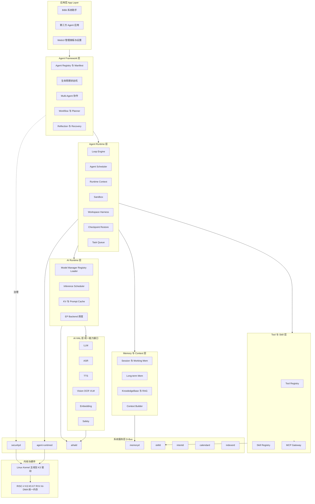

### 2.2 子系统划分与职责边界
| 子系统 | 职责（What） | 边界（不做什么） | 承载服务 |
|--------|--------------|------------------|----------|
| Agent Framework | Agent 定义/注册/生命周期/多 Agent/Workflow/Planning | 不直接执行工具、不管推理资源 | agent-runtimed（治理面）+ SDK |
| Agent Runtime | 真正运行 Agent：循环、调度、沙箱、Workspace、Checkpoint | 不定义 Agent 语义、不加载模型 | bianbu-agent-runtimed |
| AI Runtime | 模型注册/加载/多后端调度/KV·Prompt Cache | 不实现具体能力语义（那是 HAL） | bianbu-aihald |
| AI HAL | LLM/ASR/TTS/Vision/OCR/Embedding/Safety 统一接口 + 路由/Fallback | 不管模型内存生命周期（那是 Runtime） | aihald 内插件 |
| Memory & Context | 记忆存取、检索、上下文构建/压缩/排序 | 不做推理 | bianbu-memoryd + indexerd |
| Tool/Skill | 工具/技能注册、发现、调用、MCP | 不含业务逻辑（在 Skill 内） | bianbu-skilld |
| 系统服务/安全 | 权限、沙箱、审计、网络、意图、日历 | 不含应用逻辑 | securityd/intentd/calendard |

### 2.3 模块关系图
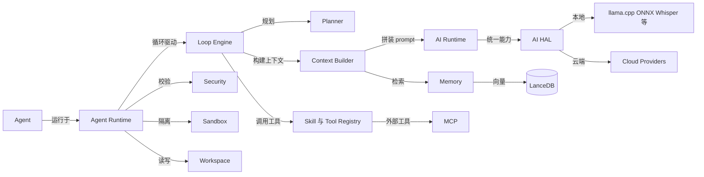

---

## 三、Agent Framework

**Why**：Agent 数量与来源多样（首方/第三方/社区），必须有统一的定义、注册、治理与协作模型，否则每个 Agent 各自为政、无法被系统管理与追溯。
**What**：定义 Agent 的身份（Manifest）、能力/权限、生命周期状态机、多 Agent 协作、Workflow/Planning/Reflection/Recovery、Session/Task 抽象。
**How**：Framework 以「声明式 Manifest + SDK 基类 + 治理服务」实现；治理面落在 agent-runtimed 的 Registry 与 FSM，执行面下沉 Agent Runtime。
**Interaction**：向下调用 Agent Runtime 执行、securityd 校验、AI Runtime 推理；向上给 SDK/CLI/BiBit。

### 3.1 Agent Manifest 与注册
```jsonc
// agent.manifest（DR-01 对齐 SRS 权限两维模型）
{
  "id": "com.bianbu.pm-assistant", "version": "1.2.0",
  "signature": "ed25519:...",
  "entry": "agent:main", "sdk": ">=1.0",
  "capabilities": [
    {"capability":"file.write","domain":"execute","risk_level":"L2","confirm":"once_per_session","scope":"~/Documents"},
    {"capability":"llm.cloud_call","domain":"resource","risk_level":"L2","confirm":"always"}
  ],
  "models": ["qwen2.5-7b","bge-small"],
  "skills": ["file-search","calendar"],
  "workflow": "plan_execute",           // 单 Agent 循环策略
  "token_budget": {"per_conversation":100000,"per_day":500000}
}
```
- 注册：`skilld`/`agent-runtimed` 校验签名（VerifyManifest）→ 写 Capability Registry → 用户授权 → 可发现/可启动。
- 能力/权限：统一引用 SRS §2 两维模型（域 × L1–L4 × 三级信任）。

### 3.2 生命周期状态机
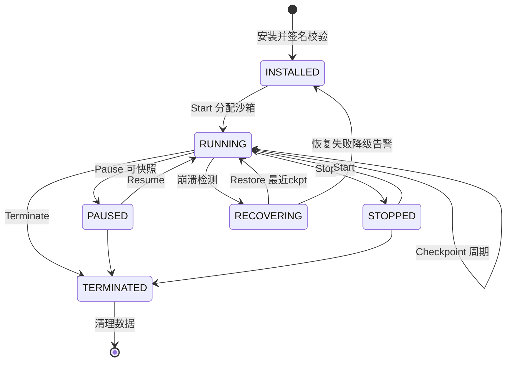
每 Agent 一个 FSM 实例 + 互斥锁，拒绝非法转换（对齐 FR-RTE-01）。

### 3.3 多 Agent 协作与 Workflow
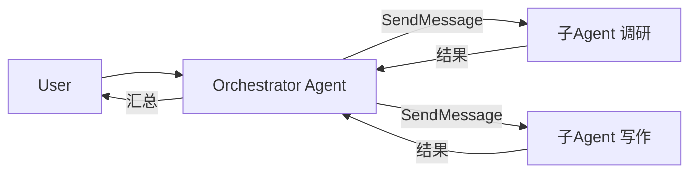
- **Workflow 模式**：`plan_execute`（默认单 Agent 循环）、`orchestrator_worker`（主从多 Agent）、`pipeline`（顺序）、`graph`（DAG）。由 Manifest 声明，Loop Engine 驱动。
- **Planning**：Planner 将目标分解为 Task DAG；**Reflection** 在每步后评估是否偏离目标；**Recovery** 在失败/崩溃时回滚到 Checkpoint 或重规划。
- **通信**：Agent 间经 `Runtime.SendMessage` 受控总线中转（非直连）；跨 Agent 访问受 Capability 门控。

### 3.4 Session / Task 抽象
- **Session**：一次用户会话，持有对话上下文、Working Memory、trace_id。
- **Task**：Session 内可调度工作单元，进入 Task Queue，可并发/取消/重试；Task 状态（PENDING/RUNNING/BLOCKED/DONE/FAILED）由 Runtime 维护。

**扩展点**：新 Workflow 模式 = 实现 `WorkflowStrategy` 接口注册；新 Planner = 实现 `Planner` 接口。

---

## 四、Agent Runtime

**Why**：Agent 需要既能高并发轻量运行、又能隔离/持久/可恢复的执行器；这是 Framework 语义的落地引擎。
**What**：生命周期执行、Agent 调度、Runtime Context、Sandbox、Workspace、Checkpoint/Rollback/Snapshot、Task Queue、并发、Cancellation、Retry。
**How**：`bianbu-agent-runtimed`（`io.bianbu.Runtime`）；沙箱采用 bind-mount + cgroup v2 + seccomp（K3 实测 overlayfs 非特权不可用，默认 bind-mount，见 BN-HLD-001 §9）。
**Interaction**：受 securityd 授权与策略；驱动 Loop Engine；经 AI Runtime 推理；读写 Workspace/Memory。

### 4.1 运行时结构
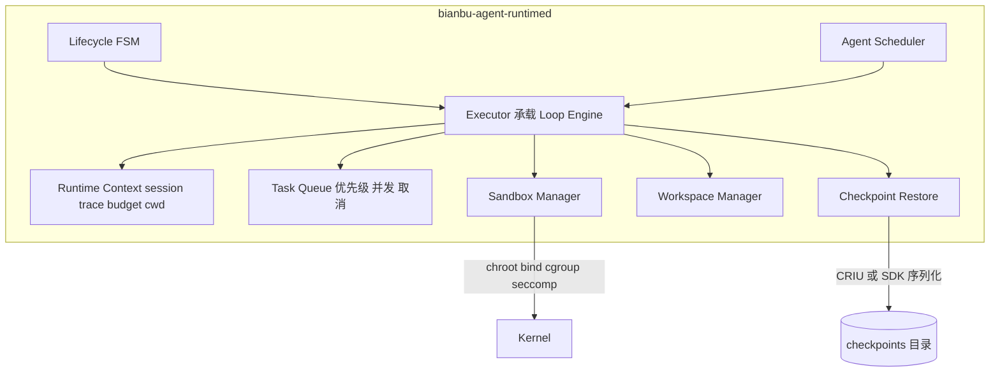

### 4.2 Runtime Context
每个运行中的 Agent 持有一个 Runtime Context：`{agent_id, session_id, trace_id, cwd(workspace), token_budget 余额, capability 快照, model 绑定, cancellation_token}`。它是循环各步的共享环境，也是 Checkpoint 的一部分。

### 4.3 调度与并发
- **Agent Scheduler**：按优先级与资源（CPU 簇 A100/X100、内存、AI 算力配额）分配，结合 cgroup 限额。
- **Task Queue**：Session 内 Task 优先级队列，支持并发上限、`Cancellation`（协作式取消令牌，循环步边界检查）、`Retry`（指数退避 + 上限）。
- **并发模型**：runtimed 事件循环 + 工作线程池；长任务（推理/工具）异步化，经 signal/回调返回。

### 4.4 Sandbox / Workspace / Checkpoint
详见第十章 Harness。要点：文件 bind-mount 隔离 + seccomp + cap drop + netfilter，失败 fail-closed（FR-SBX-07）；周期自动快照（≤500ms）、崩溃自动恢复（≥95%）、环形保留最近 10 个。

**扩展点**：新隔离级（Level2 ns / Level3 容器）= 实现 `SandboxProvider`；新持久化 = 实现 `CheckpointBackend`。

---

## 五、AI Runtime

**Why**：Agent 不应各自加载模型（内存爆炸、无法共享、后端割裂）；需要把"推理"变成"系统调用"的资源管理层。
**What**：Model Manager/Registry/Loader、推理 Session、多 Backend/Provider/EP、多模型调度、GPU/NPU/CPU 算力调度、KV Cache、Prompt Cache。
**How**：`bianbu-aihald`（`io.bianbu.AIHal`）；后端插件化（本地 llama.cpp-RVV / ONNX / 云端），单实例共享加载 + 引用计数。
**Interaction**：向上服务 Context Builder/Loop Engine/Memory（embed）；向下经 AI HAL 与硬件（RVV/AI-DMA）。

### 5.1 AI Runtime 内部结构
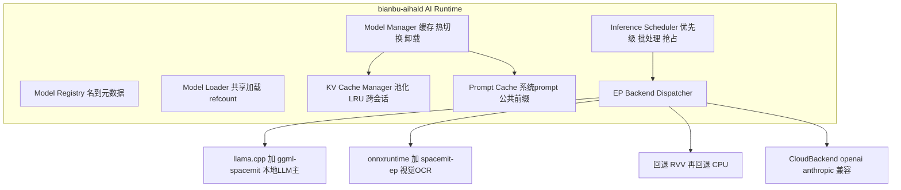

### 5.2 关键机制
- **Registry/Loader/Manager**：按模型名解析（FR-AI-01）；同模型单实例共享 refcount（FR-AI-02/04）；热切换先加载 to 再切绑定后释放 from（FR-AI-03）。
- **多模型调度**：优先级队列 + 同模型时间窗动态批处理（FR-AI-06）+ token 边界抢占（≤100ms，FR-AI-08）。
- **多 Backend/EP**：Dispatcher 按任务类别+模型 format 选后端——**LLM 本地走定制 llama.cpp + ggml-spacemit**；**视觉/OCR 走 onnxruntime + spacemit-ep**；云任务走 CloudBackend。（详见 AGENTS.md 运行平台基线）
- **算力调度**：K3 无独立 NPU，加速主通路为 **IME + TCM**——A100 簇用 **IME2+TCM**，X100 簇用 **IME1**；IME 未覆盖的算子**回退 RVV，再回退 CPU 标量**。
- **KV/Prompt Cache**：KV 池化 slab + LRU（碎片 ≤10%，淘汰 ≤1ms）；Prompt Cache 常驻公共前缀跨会话复用（FR-AI-22~24）。

### 5.3 推理 Session
一次 `Generate` 建立推理 Session：`{request_id, model, params, kv_handle, prefix_hash, stream_fd}`；流式 token 经专用 fd/signal 回传，绕开 D-Bus 大吞吐开销。

**扩展点**：新推理框架 = 实现 `InferenceBackend` 插件；新 EP（未来 NPU）= 注册 EP 描述符 + 算子映射。

---

## 六、AI HAL

**Why**：上层需要"能力"（对话/识别/合成/检索）而非"框架"；不同能力由不同引擎/模型/云实现，须统一接口并可路由/降级。
**What**：LLM / ASR / TTS / Vision / OCR / VLM / Embedding / Translation / RAG / Safety 的统一接口 + Provider 抽象 + Capability 发现 + Model Routing + Fallback。
**How**：HAL 在 aihald 内以「能力接口 + Provider 插件」实现；每能力一组标准方法，多 Provider（本地/云）注册，路由器按策略选择。
**Interaction**：AI Runtime 提供模型资源；HAL 提供语义能力；上层只认能力接口，不感知后端。

### 6.1 能力—Provider 矩阵
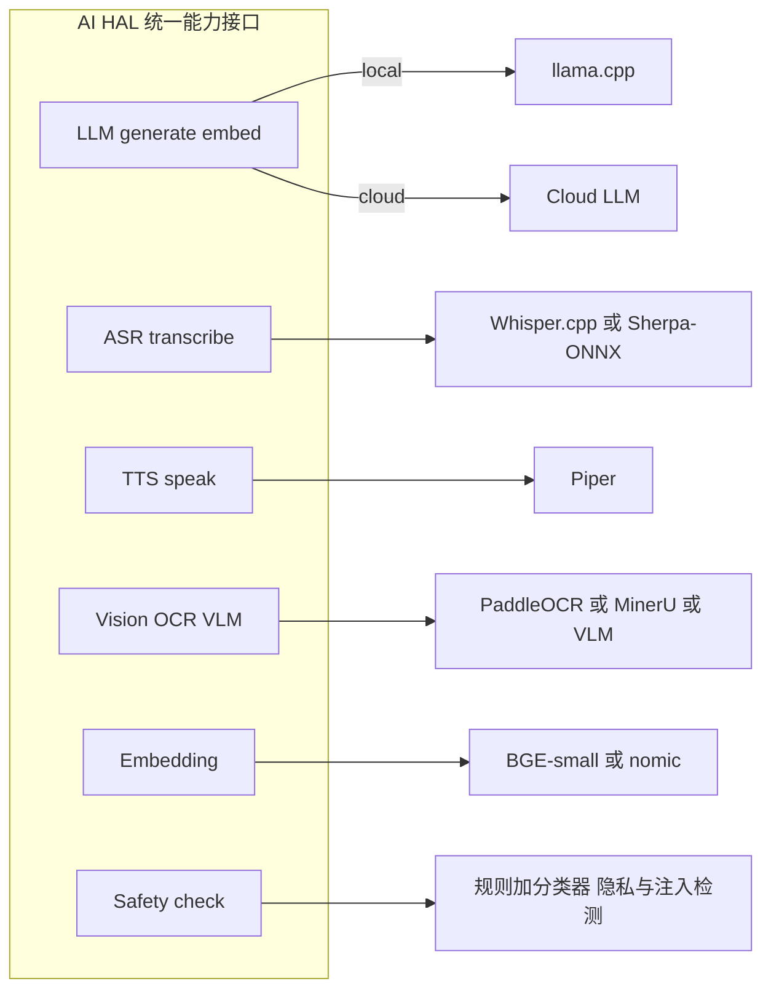

| 能力 | 本地 Provider | 云 Provider | Fallback 策略 |
|------|---------------|-------------|---------------|
| LLM | 定制 llama.cpp + ggml-spacemit（IME/TCM，回退 RVV/CPU）GGUF | openai/anthropic 兼容 | 本地置信度低/超长上下文 → 云（授权+隐私门控） |
| ASR | Whisper.cpp / Sherpa-ONNX | 云 ASR | 本地失败或高精度需求 → 云 |
| TTS | Piper | 云 TTS | 本地优先 |
| Vision/OCR/VLM | PaddleOCR / MinerU2.5 | 云 VLM | 复杂版面 → 云 |
| Embedding | BGE-small | 云 embed | 本地优先（隐私） |
| Safety | 规则+轻量分类器 | — | 强制本地 |

### 6.2 Model Routing 与 Fallback
```
route(capability, task):
  if safety.privacy_detect(task): provider = LOCAL      # 强制本地 ≥99%
  elif local.available and local.confidence>=θ: provider = LOCAL
  elif cloud.authorized: provider = CLOUD               # 透明 ≤1s
  else: provider = LOCAL(best-effort) or Error(Unavailable)
  on provider failure → next in fallback chain（不静默失败）
```

**扩展点**：新能力（VLM/Translation）= 新增能力接口 + 注册 Provider；新 Provider = 实现能力接口并声明 Capability 描述（延迟/精度/成本/隐私）供路由器决策。

---

## 七、本地 AI 能力集成（On-device AI）

**Why**：本地优先（CO-05）与隐私（NFR-Q-04）要求端侧可运行；K3 以 **IME+TCM** 为矩阵加速主通路（A100=IME2+TCM，X100=IME1），RVV/CPU 作回退，须以统一抽象纳管定制端侧栈。
**What**：以 SpacemiT 定制栈为主接入本地能力——**LLM 用定制 llama.cpp + ggml-spacemit**，**视觉/OCR/嵌入用 onnxruntime + spacemit-ep**；辅以 Whisper/Sherpa-ONNX/Piper 等，统一 Provider 抽象，支持能力发现、部署/更新/切换、注册与版本管理。
**How**：每引擎封装为实现 `InferenceBackend`/能力 Provider 的插件（`.so` + 描述符），aihald 启动时扫描注册；模型经 Model Registry 管理，支持热切换。**编译前提：llama.cpp 与 onnxruntime 均须用 SpacemiT 定制 toolchain 才能编出 IME/TCM 支持**（标准 riscv64-gnu 不行，见 AGENTS.md）。
**Interaction**：被 AI Runtime 调度、被 AI HAL 作为能力后端；模型文件由 SET 面板/CLI 部署。

### 7.1 端侧引擎接入矩阵（SpacemiT 定制栈，K3 实测适配）
| 引擎 | 用途 | K3 适配（IME/TCM 主，RVV/CPU 回退） | 状态 |
|------|------|-------------------------------------|------|
| **定制 llama.cpp + ggml-spacemit** | **LLM 本地主引擎**（GGUF） | A100=IME2+TCM，X100=IME1，回退 RVV/CPU；需定制 toolchain | 主力，M1 spike |
| **onnxruntime + spacemit-ep** | **视觉/OCR/嵌入**（riscv64 IME/TCM 适配版） | spacemit-ep 走 IME/TCM，回退 RVV/CPU；需定制 toolchain | 主力 |
| Whisper.cpp / Sherpa-ONNX | ASR | onnxruntime 路径优先接 spacemit-ep，否则 RVV | P1 |
| Piper | TTS | CPU/RVV | P1 |
| PaddleOCR / MinerU2.5 | OCR/文档 | 经 onnxruntime + spacemit-ep | P1 |
| CloudBackend | 云端 LLM/VLM | openai/anthropic 兼容 | 授权增强 |
| TensorRT / OpenVINO | GPU/x86（非 K3） | 不适用 | 可选，异构部署 |

### 7.2 插件机制与能力生命周期
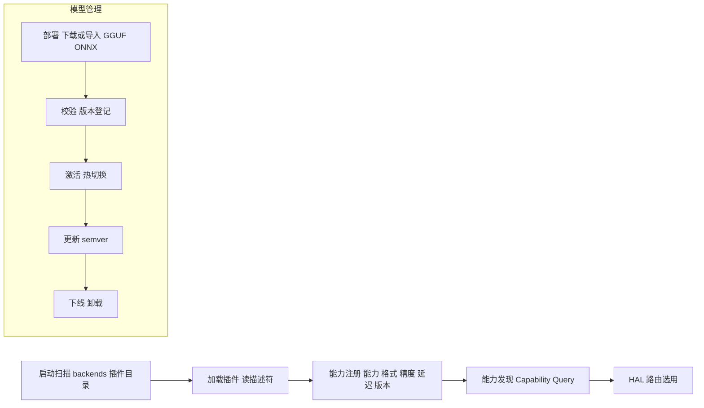
- **能力发现**：插件描述符声明 `{capability, formats, ep, perf_hint, version}`，aihald 汇总为能力目录供 HAL 路由。
- **模型部署/更新/切换**：SET-07 下载导入 → Registry 登记 → 热切换（FR-AI-03）；模型与引擎版本解耦、可回滚。
- **能力版本管理**：同能力多版本共存，按 Manifest 依赖或用户默认选择。

**扩展点**：新增端侧引擎 = 放置插件 `.so` + 描述符即被发现，无需改 aihald 核心。

---

## 八、Tool / Skill Framework

**Why**：Agent 的能力边界由工具决定；需要标准化的发现、授权、调用与分发机制，兼容行业 MCP 生态。
**What**：Tool/Skill 的生命周期、Registry、Manifest、Permission、MCP、本地/远程工具（Shell/Git/Docker/Browser/IDE 等）。
**How**：`bianbu-skilld`（`io.bianbu.Skill`）维护倒排 Registry；Skill 打包为 `.skill`（skill.toml+entry+permissions.json）；MCP Gateway 双向桥接。
**Interaction**：Loop Engine 发现/调用工具 → securityd 校验 → 沙箱执行 → 审计。

### 8.1 概念分层
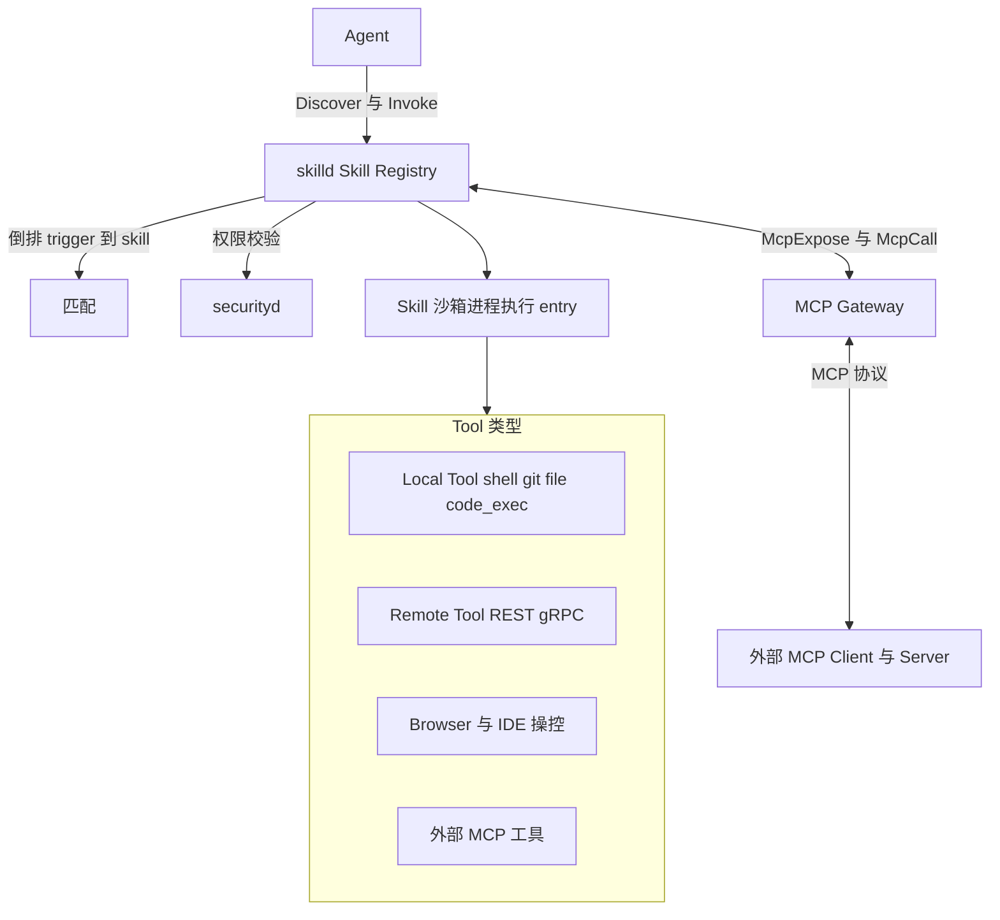

### 8.2 生命周期
- **Skill**：Install（解析 manifest+权限确认）→ Enable/Disable → 版本更新（semver）→ Uninstall（清理注册表）。
- **Tool**：注册（系统内置/应用 `@tool`/社区包）→ 发现（Discover ≤50ms）→ 调用（权限校验→执行→结果→审计）。
- **Registry**：内存倒排 `trigger_term→[skill_id]` + `skill_id→Manifest`，支持快速匹配。

### 8.3 工具类型与集成
| 类型 | 示例 | 集成方式 | 安全 |
|------|------|----------|------|
| Local Tool | shell/git/file/code_execution | 内置，沙箱内执行 | seccomp + Capability |
| App Tool | browser/editor/mail | `@tool` 注册到 Capability Registry | 权限确认 |
| Remote Tool | REST/gRPC 服务 | Skill 包声明端点 | 网络白名单 |
| Browser/IDE | 应用操控（DBus→AT-SPI→键盘→视觉，四级 fallback） | APP-01~05 | 操控受控 |
| Docker | 容器化工具（P2） | Level3 隔离 | 容器沙箱 |
| MCP Tool | 外部 MCP server | MCP Gateway 代理 | 校验+审计 |

**扩展点**：新工具 = `@tool` 装饰或 `.skill` 包；对外能力 = McpExpose 暴露为 MCP 工具。

---

## 九、Memory & Context（Context Engineering）

**Why**：LLM 上下文窗口有限且昂贵；Agent 要"越用越懂你"，必须把记忆当作被调度/压缩/淘汰的一等资源，并智能构建最终 prompt。
**What**：Session/Working/Long-term Memory、Knowledge Base、Vector DB、Embedding、Retrieval、Prompt/Context Builder、Context Compression、Context Ranking。
**How**：`bianbu-memoryd`（`io.bianbu.Memory`）+ `indexerd`（向量索引）；分层记忆 + RAG 检索 + 上下文预算调度。
**Interaction**：Loop Engine 每步经 Context Builder 组装 prompt；Builder 向 Memory 检索、向 AI Runtime 请求 embed。

### 9.1 记忆分层
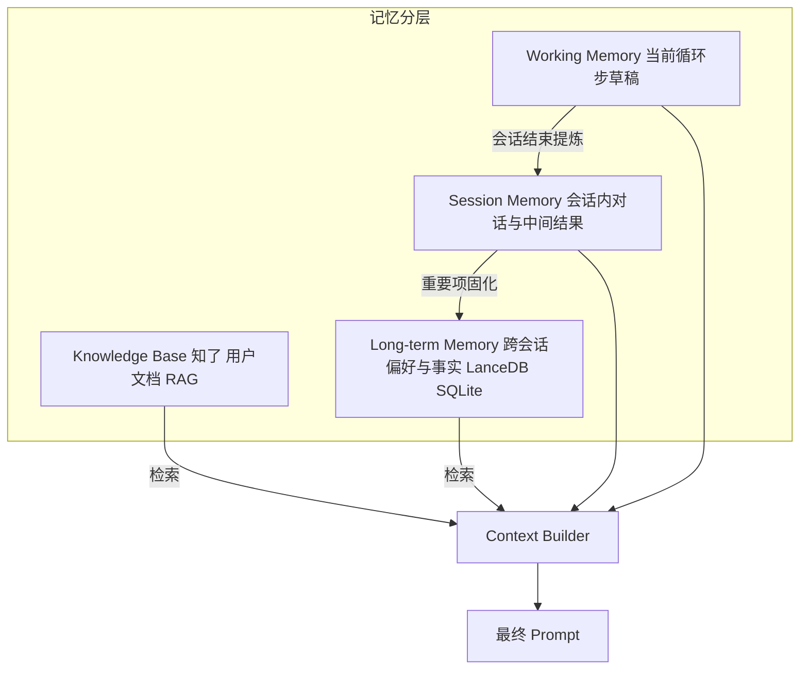

### 9.2 Context Builder / Engineering
最终 prompt 构建流水（对齐 FR-MEM-03 ≤100ms 检索）：
```
build_context(task, session):
  1. 召回: SM 最近轮次 + LTM 语义检索(top-k) + KB RAG(top-k)   [并行]
  2. 排序 Ranking: 按相关性(score)+时效+重要度加权排序
  3. 压缩 Compression: 超预算时摘要/裁剪低分片段(保结构)
  4. 预算分配: system prompt + 工具描述 + 召回上下文 + 对话历史 ≤ 模型窗口
  5. 装配: 模板化拼装 → 交 AI Runtime
```
- **Embedding**：经 AI HAL（BGE-small 本地）向量化，写/查 LanceDB。
- **Retrieval**：ANN top-k + 命名空间隔离（按 agent_id，FR-MEM-04）。
- **Compression/Ranking**：预算超限时对低分片段摘要或丢弃，保证关键上下文优先（Context Engineering 核心）。

**扩展点**：新记忆层/检索策略 = 实现 `MemoryLayer`/`Retriever` 接口；新压缩器 = `ContextCompressor` 插件。

---

## 十、Harness & Workspace

**Why**：Agent 要真实改文件/跑代码，必须在隔离、可回滚、可观测的环境中进行，防止污染宿主与不可逆破坏。
**What**：Workspace、（OverlayFS/bind-mount）、Snapshot、Rollback、File Watch、Code Graph、Git 集成、Project Isolation、Artifact、Execution Environment。
**How**：runtimed 的 Workspace Manager + Sandbox Manager；K3 上 overlayfs 不可非特权加载 → 默认 **bind-mount + 只读挂载**，overlayfs 为可选增强。
**Interaction**：Loop Engine 的工具执行在 Workspace 内发生；Checkpoint 快照 Workspace 状态；Git 提供版本回滚。

### 10.1 Workspace 结构与隔离
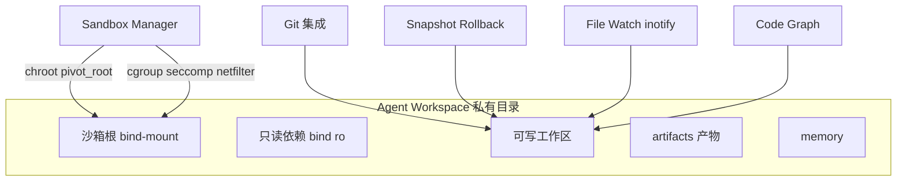

### 10.2 安全修改机制
- **Project Isolation**：每 Agent 独立 Workspace，bind-mount 限定视图；越界访问被拦截（FR-SBX-01）。
- **Snapshot/Rollback**：修改前 Git commit 或文件快照；失败/反悔一键回滚；与 Checkpoint 协同（进程状态+文件状态一致快照）。
- **File Watch / Code Graph**：inotify 监听变更增量更新索引；Code Graph 为代码类 Agent 提供符号/依赖图，供检索与影响分析。
- **Execution Environment**：代码执行工具在沙箱内运行，资源受 cgroup 限额，网络受白名单。
- **Artifact**：产物落 `artifacts/`，可导出/预览（WebUI 文件浏览器）。

**扩展点**：overlayfs（内核/权限具备时）作为写时复制增强；容器化执行环境（Level3）作为强隔离选项。

---

## 十一、Loop Engine

**Why**：Agent 的本质是"感知—决策—行动"的闭环；闭环控制、反思、评估、恢复必须由平台统一保证，而非每个 Agent 自造，否则质量与安全无法收敛。
**What**：Plan → Execute → Observe → Reflect → Evaluate →（Retry/Replan）→ Finish 的循环，含 Human Intervention、Checkpoint、Recovery、终止条件、循环控制。
**How**：Loop Engine 内建于 Agent Runtime Executor，按 Workflow 策略驱动；每步产生可观测事件与可选 Checkpoint。
**Interaction**：调 Planner 规划、Context Builder 组装、AI Runtime 推理、Skill Registry 执行工具、securityd 门禁（人审）。

### 11.1 循环状态机
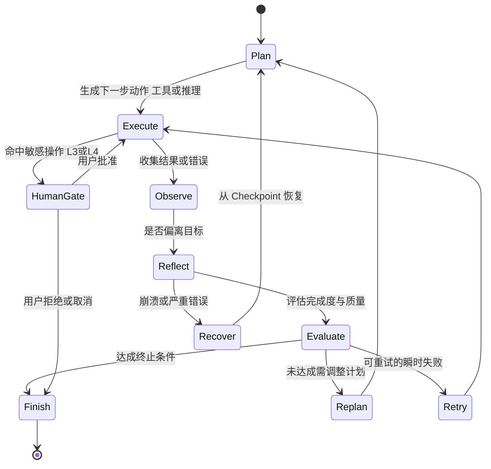

### 11.2 循环控制与终止
- **终止条件**：目标达成（Evaluate 通过）/ 超最大步数 / 超 token_budget（SEC-04）/ 超时（Timeout）/ 用户取消 / 不可恢复错误。
- **Human Intervention**：敏感动作经 Confirm Gatekeeper 暂停等待用户批准（HITL），可配置 always/once_per_session。
- **Checkpoint/Recovery**：每 N 步或关键节点自动 Checkpoint；崩溃后从最近点恢复继续循环（Agent Resume）。
- **循环控制**：防抖（重复动作检测）、防发散（Reflect 偏离度阈值触发 Replan）、成本护栏（budget 预算）。

**扩展点**：不同 Workflow 策略提供不同循环形态（单轮/多 Agent/DAG）；Evaluate/Reflect 可插自定义评估器。

---

## 十二、通信架构

**Why**：多服务、多客户端、多流式场景需要清晰的通信分层——控制面要可审计、数据面要高吞吐、事件面要实时。
**What**：D-Bus（控制面）、共享内存/UNIX socket（大吞吐数据面）、HTTP/SSE + REST（客户端接入）、MCP（工具生态）、Event Bus/信号（事件面）、（gRPC/MQ 备选）。
**How**：分面通信——系统服务间控制调用走 D-Bus；token/大数据流走旁路；WebUI/远程走 HTTP/SSE；事件经 D-Bus signal 广播。
**Interaction**：见下图消息/事件流。

### 12.1 通信分面
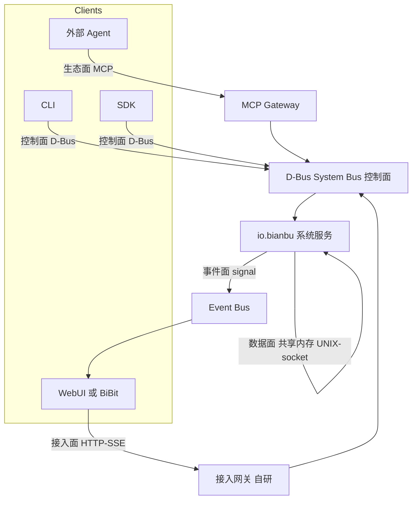

### 12.2 通信选型与场景
| 面 | 机制 | 场景 | 理由 |
|----|------|------|------|
| 控制面 | D-Bus method call | 权限校验、模型加载、Skill 调用、生命周期 | 标准化、可审计、类比 Android Binder |
| 数据面 | 共享内存 / UNIX socket / 专用 fd | 推理 token 流、大文件/向量 | 规避 D-Bus 序列化开销（首 token/吞吐敏感） |
| 接入面 | HTTP/SSE + REST | WebUI/BiBit/远程客户端、流式对话 | 浏览器友好、流式 |
| 生态面 | MCP | 外部工具双向调用 | 行业标准兼容 |
| 事件面 | D-Bus signal / Event Bus | 状态变更、资源/安全告警、进度 | 实时广播、解耦 |
| 备选 | gRPC / Message Queue | 跨机分布式（未来） | 强类型/异步削峰 |

**扩展点**：接入面可加 gRPC；事件面可接 MQ 支持分布式部署。

---

## 十三、数据流（端到端）

**Why**：需要一条贯穿全栈的清晰主链，作为各模块协作与性能预算分解的基准。
**What**：用户请求 → Intent → Planner → Agent → Tool → AI Runtime → Model → Memory → Response 的完整数据流与时序。

### 13.1 主数据流图
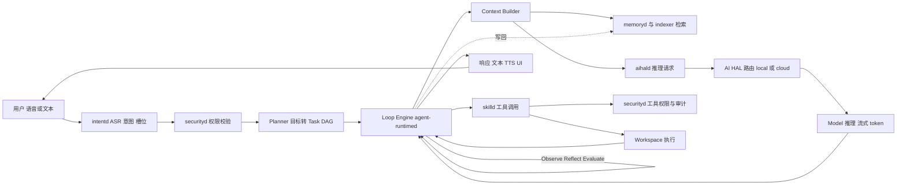

### 13.2 端到端时序（语音指令，对齐 NFR-P-05 ≤1.5s）
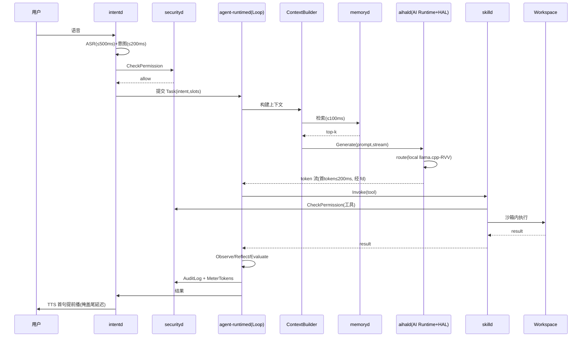
预算分解：ASR≤500ms ∥ 意图≤200ms → 首 token≤200ms（流式）→ 工具执行 → TTS 首句提前，串行压至 ≤1.5s（[TBD-15] K3 baseline 锁定）。

---

## 十四、安全体系

**Why**：Agent 能自主执行、访问数据、联网，风险面远大于传统应用；安全必须内生、贯穿调用链、可审计。
**What**：Capability、Permission、Sandbox、Workspace Isolation、Prompt/Tool Injection 防护、Secret 管理、审计、日志、数据安全。
**How**：securityd 为信任根；每次能力调用经 CheckPermission→Confirm→执行→AuditLog；沙箱内核隔离；无 TEE 故 Secret 用软件方案。

### 14.1 安全纵深
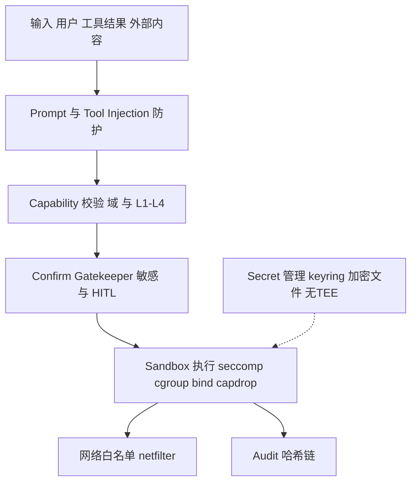
| 层 | 机制 | 对应 SRS |
|----|------|----------|
| 权限 | Capability Registry 两维模型 + 三级信任 | FR-SEC-01/02 |
| 门禁 | Confirm Gatekeeper（L3/L4 强确认，L4 二次） | FR-SEC-03 |
| 沙箱 | seccomp-bpf + cgroup v2 + bind-mount + cap drop | FR-SBX-01~07 |
| 网络 | netfilter 白名单默认 DROP + 学习模式 | FR-SEC-07/SET-18 |
| 审计 | SHA256 哈希链，可导出可验证 | FR-SEC-06 |
| 预算 | token_budget 计量超限暂停 | FR-SEC-04 |
| Injection 防护 | 输入/工具结果视为不可信；隔离指令与数据；Safety 分类器检测 | 新增 |
| Secret | 无 TEE → gnome-keyring / 加密文件 + root 权限 + securityd 代理 | FR-AI-21（降级） |
| 数据安全 | 隐私任务强制本地；记忆按 Agent 隔离；日志脱敏 | FR-AI-19/MEM-04 |

### 14.2 Prompt / Tool Injection 防护
- 外部内容（网页、文件、工具返回）一律标记为**不可信数据**，与系统指令物理分隔（结构化包裹），不直接拼入指令区。
- 工具调用参数经 schema 校验 + Capability 约束，防止 Agent 被诱导越权调用。
- Safety Provider 对输入/输出做注入模式与敏感数据检测，命中则拦截或降级本地。

---

## 十五、性能设计

**Why**：交互式 Agent 对延迟与并发敏感；K3 无独立 NPU，须靠 CPU 双簇+RVV+缓存榨取性能。
**What**：首 token 延迟、推理性能、Agent/多模型并发、调度策略、多级缓存。

| 维度 | 目标 | 手段 |
|------|------|------|
| 首 token | ≤200ms（目标值，K3 baseline） | 模型常驻缓存、Prompt Cache 命中、ggml-spacemit 走 IME/TCM 加速算子、流式输出 |
| 推理吞吐 | 动态批处理提升 ≥2x | 同模型时间窗合批（FR-AI-06） |
| Agent 并发 | 冷启动 ≤200ms，≤50MB/Agent 空闲 | bind-mount 轻沙箱、模板复用、cgroup 限额 |
| 多模型并发 | 3 模型延迟↑≤30% | Inference Scheduler 优先级+抢占 |
| 调度策略 | — | 优先级队列 + token 边界抢占（≤100ms）+ 算力簇分配 |
| 缓存 | — | KV Cache（碎片≤10%）、Prompt Cache（跨会话前缀）、Workspace Cache（overlay/bind 模板）、Memory Cache（热记忆常驻） |

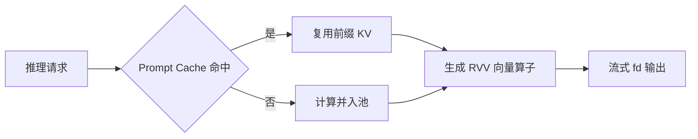

---

## 十六、可靠性设计

**Why**：长时运行（7 天）、崩溃、超时不可避免；平台须保证 Agent 可恢复、不丢状态。
**What**：Retry、Timeout、Recovery、Rollback、Snapshot、Checkpoint、Crash Recovery、Agent Resume。

| 机制 | 策略 | 对应 |
|------|------|------|
| Retry | 瞬时失败指数退避 + 次数上限，循环步边界重试 | Loop Engine |
| Timeout | 每步/整体超时，触发取消或降级 | Task Queue |
| Checkpoint | 周期自动（≤500ms）+ 关键节点 + 手动 | FR-RTE-07/08 |
| Snapshot/Rollback | Workspace 文件快照 + Git，进程+文件一致快照 | 第十章 |
| Crash Recovery | 监控退出码，异常→取最新 ckpt→Restore（≥95%） | FR-RTE-10 |
| Agent Resume | 从 Checkpoint 恢复 Runtime Context 继续循环 | Loop Engine |
| 降级 | 恢复失败→重置到 INSTALLED+告警；云端不可达→本地 best-effort；不静默失败 | fail-closed |

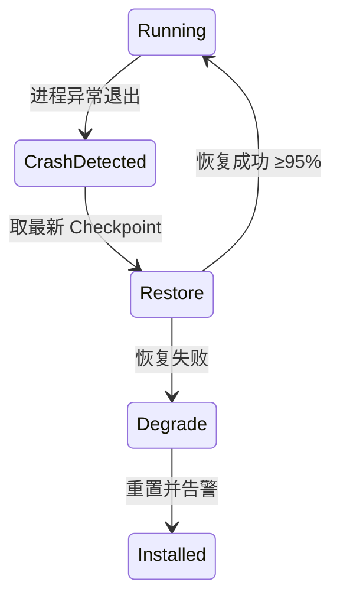

---

## 十七、可扩展架构

**Why**：生态与硬件持续演进（K5/K7、新模型、新框架）；核心须稳定，扩展须插件化、不改内核。
**What/How**：各子系统预留扩展接口，能力经描述符注册、由 Registry/路由动态发现。

| 扩展维度 | 扩展方式 | 涉及接口 |
|----------|----------|----------|
| 新 Agent | 打包 Manifest + SDK，签名安装 | Agent Registry |
| 新 Skill/Tool | `.skill` 包 / `@tool` 注册 / MCP 暴露 | Skill Registry |
| 新 AI Runtime/推理框架 | 实现 `InferenceBackend` 插件 `.so`+描述符 | AI Runtime EP |
| 新模型 | Registry 部署+版本登记，热切换 | Model Registry |
| 新硬件（NPU/GPU） | 注册新 EP + 算子映射（如未来 K5 NPU） | EP Dispatcher |
| 新 Provider（能力/云） | 实现能力接口+Capability 描述 | AI HAL 路由 |
| 云端能力 | 注册 CloudProvider（openai/anthropic 兼容等） | Endpoint Decision |
| 新 Workflow/Planner | 实现 `WorkflowStrategy`/`Planner` | Agent Framework |

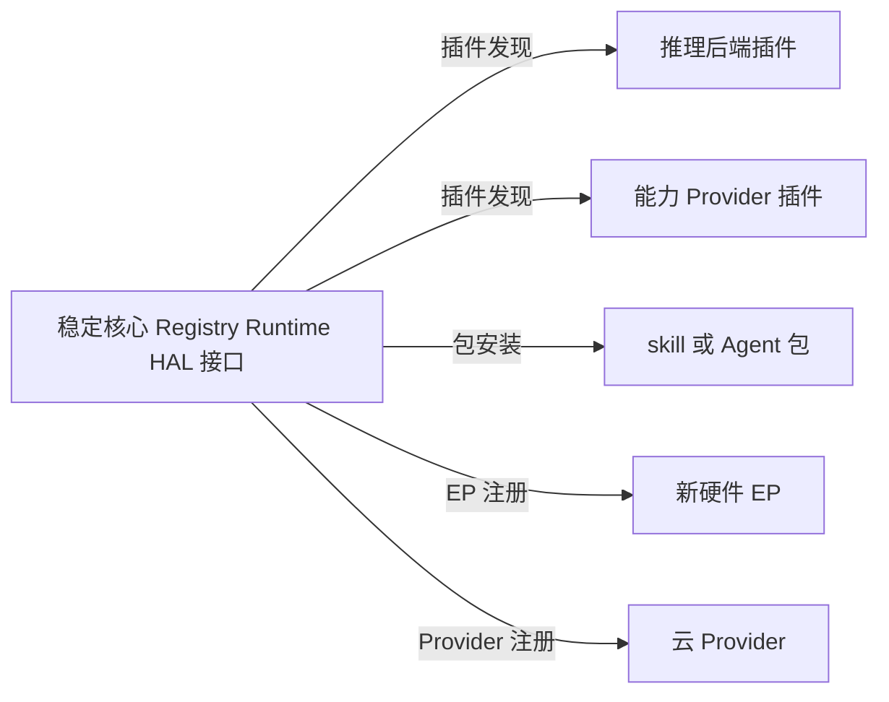

---

## 十八、开发者生态

**Why**：底座价值取决于开发者能否低门槛扩展；须提供分层 SDK、清晰 API/IDL 与完整工具链。
**What**：Agent SDK、AI SDK、Tool SDK、Skill SDK、插件机制、API/IDL、示例工程、调试/Profiling/日志。

### 18.1 SDK 分层
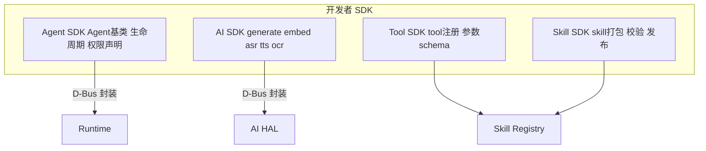
| SDK | 面向 | 关键 API | 对应 |
|-----|------|----------|------|
| Agent SDK | Agent 开发者 | `Agent` 基类、`on_start/pause/stop`、`register_tool` | FR-SDK-01 |
| AI SDK | 调用 AI 能力 | `llm.generate`、`embed`、`asr/tts/ocr` | FR-SDK-05 |
| Tool SDK | 暴露工具 | `@tool(permission,confirm)` | FR-SDK-02/03 |
| Skill SDK | 打包分发 | `@tool(skill_package=True)`、`bianbu_agent_sdk.skill` | FR-SDK-09 |

### 18.2 API / IDL 与工具链
- **API/IDL**：D-Bus 接口即 IDL（见 BN-API-001），SDK 为其高层封装；MCP schema 为工具生态 IDL。
- **CLI**：`bianbu-agent init/build/run/logs/status/install/uninstall/checkpoint`、`bianbu-skill list/install/call/uninstall`。
- **调试/Profiling**：`bianbu-agent bench`（延迟/吞吐/内存/功耗，ns 级）、`doctor`（环境诊断，须检测 SpacemiT 定制 toolchain、ggml-spacemit、spacemit-ep、IME/TCM 驱动、TEE 缺失并给建议）、`logs --follow`（分级日志，自动关联 agent_id + trace_id）。
- **示例工程**：`init` 生成含 agent.py + manifest + README 的可运行模板。
- **日志系统**：trace_id 贯穿意图→规划→推理→工具→审计，统一可观测。

**扩展点**：C++ SDK（远期 FR-SDK-08）；插件市场（ECO/Agent Hub）分发 Agent/Skill/Provider。

---

## 附录 A：全局部署视图
```mermaid
flowchart TB
  subgraph Host["Bianbu 4.0.1 on RISC-V K3"]
    subgraph systemd
      SEC["securityd"]
      RT["agent-runtimed"]
      AIH["aihald"]
      MEMD["memoryd"]
      SKD["skilld"]
      INT["intentd"]
      CAL["calendard"]
      IDX["indexerd"]
    end
    GW["接入网关 HTTP-SSE 与 MCP"]
    subgraph AgentsRun["沙箱 Agent 进程"]
      Ag1["Agent A bind-mount cgroup seccomp"]
      Ag2["Agent B"]
    end
    Models[("模型库 GGUF ONNX")]
    VDB[("LanceDB")]
    Ckpt[("checkpoints")]
    Audit[("审计链")]
  end
  Cloud["进迭时空社区 AI 或云 LLM"]
  GW-->SEC
  Ag1-->RT
  RT-->AIH
  AIH-->Models
  AIH-->Cloud
  MEMD-->VDB
  RT-->Ckpt
  SEC-->Audit
  HW["RVV 加 ai_dma 加统一内存 无NPU 无TEE"]
  AIH-->HW
```

## 附录 B：模块依赖与接口一览
| 模块 | 服务/接口 | 依赖 | 扩展点 |
|------|-----------|------|--------|
| Agent Framework | SDK + Registry | runtimed, securityd | WorkflowStrategy/Planner |
| Agent Runtime | io.bianbu.Runtime | securityd, aihald | SandboxProvider/CheckpointBackend |
| AI Runtime | io.bianbu.AIHal | HAL 后端, 硬件 | InferenceBackend/EP |
| AI HAL | 能力接口 | AI Runtime | 能力 Provider |
| Memory/Context | io.bianbu.Memory | aihald(embed), indexerd | MemoryLayer/Retriever/Compressor |
| Tool/Skill | io.bianbu.Skill | securityd, MCP | .skill/@tool/Provider |
| Security | io.bianbu.Security | 内核(seccomp/cgroup) | NetworkPolicy/Vault |
| Intent | io.bianbu.Intent | aihald | 意图类/分类器 |

## 附录 C：可追溯性与遗留
- 需求追溯：本 HLD 各章对应 SRS FR-SEC/SBX/AI/RTE/MEM/CAL/INT/ASR/DCO/OCR/VEC/SKL/APP/SDK/SET/ECO。
- 硬件事实：SpacemiT K3（A100+X100, IME2+TCM/IME1 加速, RVV/CPU 回退, PowerVR, 无独立 NPU/TEE, 31GB, Bianbu 4.0.1）。
- 本地 AI 栈：LLM=定制 llama.cpp+ggml-spacemit；视觉/OCR=onnxruntime+spacemit-ep；均需 SpacemiT 定制 toolchain（见 AGENTS.md 运行平台基线）。
- 遗留（TBD，对齐 PRD 12.2）：[TBD-14] RISC-V 组件成熟度须编译验证、[TBD-15] 性能 baseline 实测、[TBD-17] 无 TEE 定稿软件密钥、[TBD-8] 日历后端、[TBD-5/6] 记忆存储选型/路径。
- 复用边界：全栈自研，worker 上 agentforce/hermes 仅作方向印证与硬件校准，不复用（见 AGENTS.md）。

---
*BN-HLD-002 V1.0 · 企业级 Agent OS HLD · 输入 SRS(BN-SRS-001)+BN-HLD-001+PRD V0.9+worker 实测。内容由 AI 辅助生成，可作为 LLD/接口设计/研发实施基础。*


